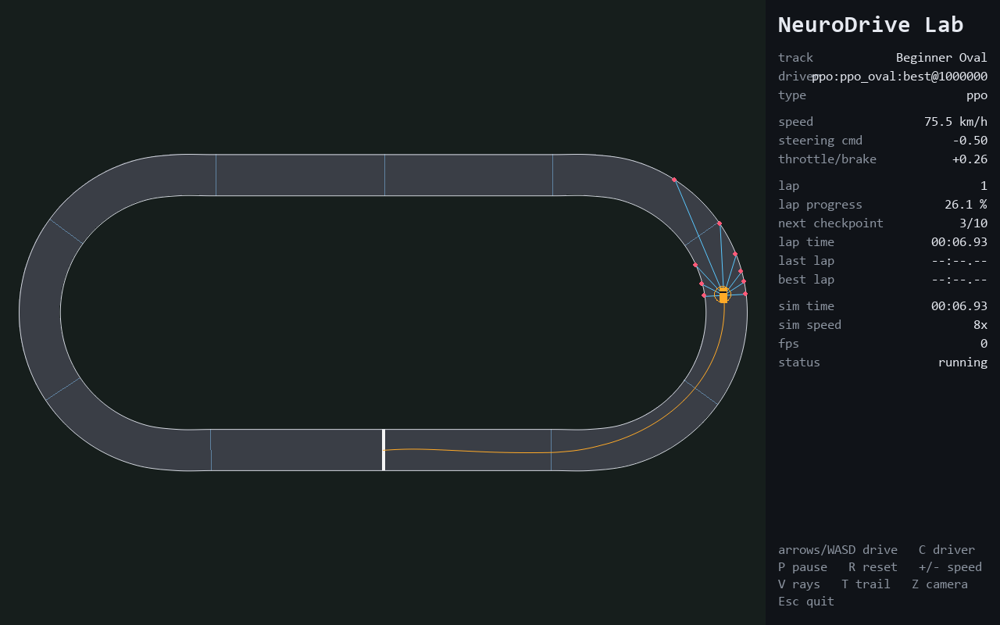

# NeuroDrive Lab

A 2D top-down driving simulator built as a controlled experiment: can a car learn to drive
by itself, and how do **reinforcement learning (PPO)** and **neuroevolution (NEAT)** compare
when they get the same car, sensors, tracks and budget?

> **Status: Phase 5 of 8: generalization.** Trained only on the oval, both agents
> overfit: they never learned right turns (PPO completed 4% of laps on clockwise tracks,
> NEAT 0%). Trained on three varied tracks, **both complete 100% of laps on 26 tracks,
> 22 of them never seen in training**: PPO in 22.50 s on average, NEAT in 21.63 s. One
> seed each, unequal budgets: the fair comparison is Phase 6. See
> [results](docs/results.md).



## What exists today

- Deterministic 2D car physics (kinematic bicycle model with steering rate and grip limits)
- Tracks defined as YAML files (centerline + width), validated on load
- Progress, ordered checkpoints, lap counting and lap timing that can't be cheated by
  shortcuts, reversing over the line or rocking over a gate
- Headless simulation and a throughput benchmark
- 9 raycast distance sensors and an 11-number observation vector
- A Gymnasium environment (`NeuroDrive-v0`) that passes the Gymnasium and
  Stable-Baselines3 checkers, with a reward designed against known exploits
- Baseline drivers: random, smoothed random, a sensors-only heuristic, and a
  privileged scripted autopilot
- An evaluator: fixed shared scenarios, one CSV row per episode, summaries with
  confidence intervals
- A pygame-ce playground: keyboard driving, baseline drivers, sensor-ray overlay, pause,
  0.25×–8× speed, follow camera
- PPO training (Stable-Baselines3): configs, seeds, checkpoints from step 0, TensorBoard,
  validation-based checkpoint selection, resume, and trained-model playback
- NEAT neuroevolution (neat-python): parallel scoring, per-generation champions and
  statistics, validation-based selection, reproducible runs, evolved-network drawings
- 6 tracks (train / validation / test, both directions) plus unlimited procedural test
  tracks; random start points; multi-track training; split rules enforced in code
- 174 automated tests

Not built yet: the multi-seed PPO-vs-NEAT benchmark, replays, the polished UI. See
[docs/architecture-review.md](docs/architecture-review.md).

## Install (Windows PowerShell)

Requires [uv](https://docs.astral.sh/uv/). uv downloads Python 3.12 if needed.

```powershell
git clone <this repo>
cd NeuroDrive-Lab
uv sync
```

## Quick start

```powershell
# Drive the car yourself (arrow keys / WASD)
uv run python -m neurodrive play

# Watch a baseline driver (press C in the window to cycle drivers, V for sensor rays)
uv run python -m neurodrive play --driver heuristic

# Evaluate a driver on 100 fixed validation scenarios (writes runs/eval/...)
uv run python -m neurodrive evaluate --controller heuristic --episodes 100

# Train PPO (about 25 minutes), then watch and evaluate it
uv run python -m neurodrive train ppo --config configs/ppo/default.yaml
uv run python -m neurodrive play --model runs/ppo/<run>/best_model.zip
uv run python -m neurodrive evaluate --model runs/ppo/<run>/best_model.zip --episodes 100
uv run tensorboard --logdir runs/ppo

# Evolve NEAT drivers (about 18 minutes), watch the best, draw its network
uv run python -m neurodrive train neat --config configs/neat/default.yaml
uv run python -m neurodrive play --model runs/neat/<run>/best_model.pkl
uv run python -m neurodrive show-network runs/neat/<run>/best_model.pkl

# Train on several tracks, then test on tracks never seen in training
uv run python -m neurodrive train ppo --config configs/ppo/multitrack.yaml
uv run python -m neurodrive evaluate --model runs/ppo/<run>/best_model.zip --tracks "split:test,proc:20" --start random --split test
uv run python -m neurodrive play --track unseen_a --model runs/ppo/<run>/best_model.zip

# Measure headless simulation speed
uv run python -m neurodrive bench-sim --steps 100000

# Check a track file
uv run python -m neurodrive validate-track beginner_oval
uv run python -m neurodrive list-tracks

# Tests and lint
uv run pytest
uv run ruff check .
```

### Playground controls

| Key | Action |
|---|---|
| Arrows / WASD | Steer, throttle, brake |
| C | Cycle driver: keyboard → heuristic → smoothed random → autopilot → trained model (only with `--model`) |
| V | Show/hide the distance-sensor rays |
| P | Pause / resume |
| R | Reset to the start line |
| + / − | Simulation speed 0.25× … 8× |
| Z | Camera: whole track ↔ follow the car |
| T | Show/hide the driven path |
| Esc | Quit |

A crash (any corner of the car leaving the track) ends the run; press R.

## Project layout

```
src/neurodrive/
  sim/          physics, tracks, sensors, progress, simulation (pure NumPy, no graphics)
  tracks/       track YAML files
  env/          Gymnasium environment: config, observations, rewards
  agents/       Controller interface, baselines, PPO and NEAT controllers, model loading
  training/     PPO and NEAT training: configs, run folders
  viz/          network drawings and NEAT plots
  evaluation/   scenarios, evaluator, metrics
  experiments/  run metadata (versions, git commit)
  ui/           pygame-ce playground
  bench.py      headless throughput benchmark
  cli.py        python -m neurodrive ...
configs/        environment, PPO and NEAT experiment configs
scripts/        generate_tracks.py (how the built-in tracks were made)
tests/          unit, integration, smoke
docs/           spec, architecture review, physics, measured results
```

## Documentation

- [docs/SPEC.md](docs/SPEC.md): the original project specification
- [docs/architecture-review.md](docs/architecture-review.md): Phase 0 design review and roadmap
- [docs/physics.md](docs/physics.md): how the car, track, collisions and laps work
- [docs/ml-guide.md](docs/ml-guide.md): the learning problem: observations, actions, reward, endings
- [docs/training-guide.md](docs/training-guide.md): how to train, watch, resume and evaluate
- [docs/results.md](docs/results.md): measured numbers only, with commands
- [docs/phases/phase-1.md](docs/phases/phase-1.md), [docs/phases/phase-2.md](docs/phases/phase-2.md),
  [docs/phases/phase-3.md](docs/phases/phase-3.md),
  [docs/phases/phase-4.md](docs/phases/phase-4.md),
  [docs/phases/phase-5.md](docs/phases/phase-5.md): phase reports

## License

Not chosen yet.
