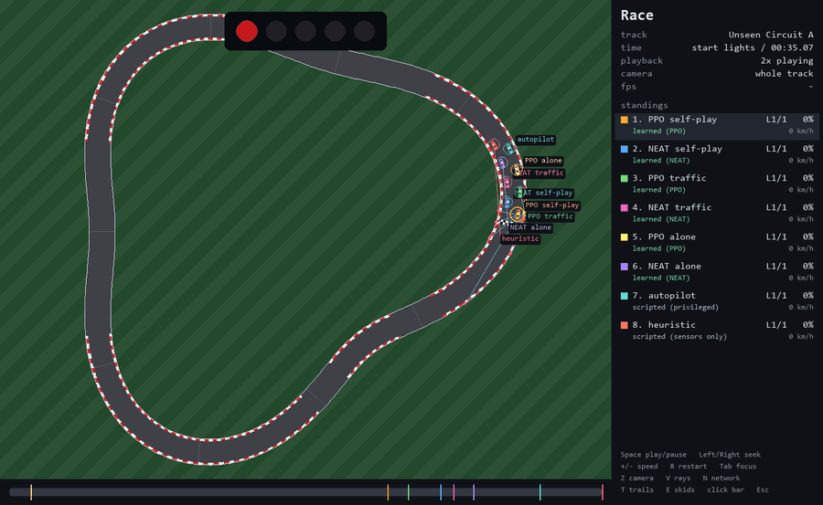
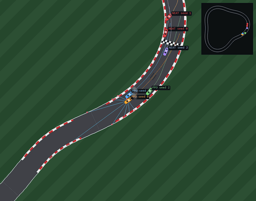
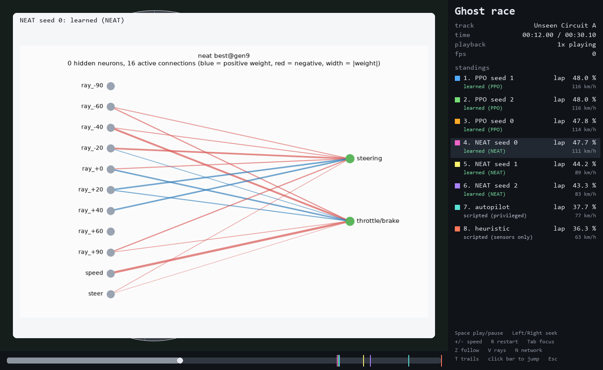
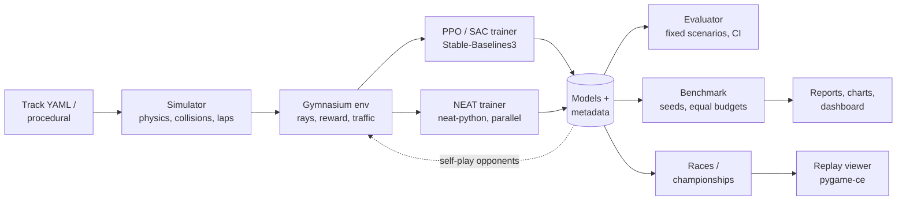

<div align="center">

# NeuroDrive Lab

**A 2D driving simulator where cars teach themselves to drive and race, built as a
controlled experiment: reinforcement learning (PPO, SAC) vs. neuroevolution (NEAT).**


[](LICENSE)



*One real race on a track no driver trained on: cars see each other through their sensors and
collide. The self-play PPO driver wins; the PPO driver trained alone crashes within a second.
One race at 2x speed; the measured results are below.*

</div>

---

## At a glance

- **Three algorithms, compared fairly.** Same car, same sensors, same tracks, equal
  environment-step budgets, 3 seeds each, tested on 26 tracks (22 never seen in training).
- **The winner depends on the budget.** At 1M steps PPO laps fastest; at 5M steps NEAT
  is both faster and perfect (1,560 of 1,560 test laps).
- **SAC learns from the fewest steps** (first laps after ~100k) but costs ~10x PPO's compute.
- **Self-play makes the best racers.** Trained against earlier AI drivers, NEAT completes
  98% of races against opponents it has never met; PPO self-play wins the championship.
- **Honest negative results too:** PPO tuning sped learning up 2x but did not make it more
  reliable; drivers trained alone on slippery tyres lose a quarter to a third of their laps in traffic.
- **Everything is reproducible:** every number has its command, seed, date and hardware.

## Overview

NeuroDrive Lab asks one question carefully: **given the same car, the same sensors, the
same tracks and the same training budget, how do gradient-based reinforcement learning and
an evolutionary algorithm compare at learning to drive, and then to race?**

Everything needed to answer that honestly is built in: a deterministic physics simulator
(with an optional tyre-slip model), a Gymnasium environment, three learning pipelines,
scripted baselines, strict train/validation/test track splits, a multi-seed benchmark with
confidence intervals, multi-car racing with self-play, and a broadcast-style replay viewer.

| | |
|---|---|
| **Algorithms** | PPO and SAC (Stable-Baselines3), NEAT (neat-python) |
| **Agent inputs** | 9 distance rays, speed, steering angle (no map, no track knowledge) |
| **Agent outputs** | Steering and throttle/brake, continuous in [-1, 1] |
| **Tracks** | 6 hand-built (train / validation / test, both directions) + unlimited procedural |
| **Evaluation** | 26 tracks x 20 fixed scenarios with random starts, 3 seeds per algorithm |
| **Quality** | 255 automated tests (pytest, ruff, mypy), fully reproducible runs |

## Key results

### 1. Three algorithms, one fair benchmark

All trained on three tracks with identical environment-step budgets, 3 seeds each, then
tested on 26 tracks x 20 scenarios. Best checkpoints chosen on 7 validation tracks, never on
test tracks.

| At 1M steps | PPO | SAC | NEAT |
|---|---|---|---|
| Laps completed | 97.6% ± 4.1 | 97.8% ± 1.4 | **98.8% ± 2.0** |
| Mean lap time | **22.40 s** | 22.50 s | 24.21 s |
| Steps to first validation lap | 283k | **100k** | 133k |
| Training time per run (CPU) | ~30 min | ~4-9 h | **~2 min** |

| PPO vs. NEAT with 5x the budget (5M steps) | PPO | NEAT |
|---|---|---|
| Laps completed | 96.9% ± 4.8 | **100.0% ± 0.0** |
| Mean lap time | 22.43 s | **21.56 s** |

<sub>Mean ± standard deviation across seeds. Reference drivers on the same scenarios:
scripted autopilot 28.02 s, sensor heuristic 29.56 s (both 100%). Reports:
[1M](results/benchmark/ppo_vs_neat_1m/reselection.md),
[SAC](results/benchmark/sac_1m/report.md),
[5M](results/benchmark/ppo_vs_neat_5m/reselection.md).</sub>

- **Budget decides the ranking.** At 1M steps PPO is faster on all 26 tracks; at 5M NEAT
  is faster on 25 of 26 and completes every test lap. PPO plateaued; NEAT kept improving.
- **SAC is the most sample-efficient** (two seeds lapped after only 50k steps) and varies
  least between seeds, but one gradient step per environment step makes it slow on a CPU.
- **How the checkpoint is chosen matters as much as training length.** Picking it on 7
  validation tracks instead of 1, with no retraining, raised PPO from 92.6% to 97.6% of laps
  at 1M and from 87.8% to 96.9% at 5M.
- An early comparison with unequal budgets had NEAT faster at 1M too. Equal budgets and
  several seeds are what make the comparison meaningful; the benchmark runner enforces both.

### 2. Racing: self-play makes the most reliable racers

In real races cars see each other through their sensors and collide. Tested on 22 tracks
with 3 opponents, 3 seeds per model; "learned opponents" are AI drivers none of the models
trained against.

| Driver | Laps completed, scripted opponents | Laps completed, learned opponents |
|---|---|---|
| PPO trained alone | 85.2% | 82.3% |
| PPO trained with traffic | 93.0% | 88.9% |
| **PPO self-play** | **96.1%** | **95.3%** |
| NEAT trained alone | 51.2% | 90.9% |
| NEAT trained with traffic | 96.9% | 95.9% |
| **NEAT self-play** | **98.6%** | **98.1%** |

- **Self-play** (training against a league of earlier AI drivers at full pace, plus scripted
  cars) gives the most reliable driver of each algorithm and the smallest spread between seeds.
- **The algorithms race differently.** NEAT trained alone avoids other cars but swerves into
  the wall to do so; PPO bumps its way through.
- **Championships:** three 8-car championships (one per seed, rotated grids, F1 points). PPO
  self-play won on points (507, top two in every seed), ahead of NEAT trained with traffic (483).

[Self-play report](docs/phases/phase-12.md) ·
[standings](results/grand_prix/phase12/summary.md) ·
[traffic results](docs/phases/phase-10.md)

### 3. Hard physics: fast and reckless vs. slow and careful

With tyres that can slip (understeer, oversteer, spins), 3M steps, 3 seeds:

| | PPO | NEAT | Scripted autopilot | Sensor heuristic |
|---|---|---|---|---|
| Laps completed | 77.2% | **88.1%** | 100% | 30.0% |
| Mean lap time | **27.75 s** | 33.95 s | 38.03 s | 32.04 s |
| Crashes | 22.8% | **1.9%** | 0% | 70.0% |

Hand-written rules that work on the easy physics fail 70% of the time here; both learned
agents adapt. **Racing on slippery tyres is much harder still:** with 3 cars on track, these
drivers (trained alone) fall from 85% to 63% of laps (PPO) and from 99.9% to 69% (NEAT),
while the scripted autopilot still laps 100%.
[Benchmark](results/benchmark/ppo_vs_neat_dynamic_3m/report.md) ·
[racing](docs/phases/phase-14.md)

<p align="center">
  
</p>

### 4. Training on one track overfits, in a very specific way

| Trained on | Laps completed, 26 tracks | Counter-clockwise tracks | Clockwise tracks |
|---|---|---|---|
| Oval only (PPO) | 63.7% | 95% | **4%** |
| Oval only (NEAT) | 37.5% | 57% | **0%** |
| 3 varied tracks (PPO / NEAT) | **100% / 100%** | 100% | 100% |

The oval only turns left, so the agents never learned to turn right. Training on three
tracks in both directions fixed it completely, including on 22 tracks never seen in training.

### 5. Tuning PPO helps speed, not reliability

A validation-only hyperparameter search (`neurodrive tune ppo`, 8 settings x 2 seeds) found
settings that learn about **twice as fast** and lap 0.5 s quicker. On fresh seeds and the test
tracks they still completed 94.8% of laps, against 94.3% for the defaults: PPO's
seed-to-seed spread is not a hyperparameter problem. [Search](results/tuning/ppo/report.md)

### 6. Evolution finds tiny solutions

The best NEAT driver of one benchmark seed has **no hidden neurons**: 16 direct connections
from the sensors to the controls, and it laps every test track. The PPO policy has 5,058
weights.

<p align="center">
  
</p>

An interactive version of these results (filters, hover details, table views, light/dark)
is in [results/dashboard.html](results/dashboard.html): download it and open it in a browser,
or regenerate it with `neurodrive dashboard`. Every number, with its command, date and
hardware, is in [docs/results.md](docs/results.md).

## Features

**Simulation**
- Kinematic bicycle model with steering-rate and grip limits; optional **dynamic
  tyre-slip model** (understeer, oversteer, spins; friction circle; traction control)
- Tracks as YAML centerline + width, validated on load; procedural track generator with
  separate validation and test seeds
- Exact collision (oriented car rectangle vs. track corridor) and cheat-proof lap counting
  (ordered checkpoints; no shortcuts, reversing over the line, or gate rocking)
- Deterministic fixed time step: every run and replay can be reproduced exactly

**Learning**
- Gymnasium environment (`NeuroDrive-v0`) passing the Gymnasium and SB3 environment checkers
- Reward designed against known exploits; `terminated` vs. `truncated` handled correctly
- PPO, SAC and NEAT pipelines with seeds, checkpoints, resume, TensorBoard / statistics, and
  checkpoint selection on separate validation tracks; re-selection after training
- Validation-only hyperparameter search for PPO (`tune ppo`)
- Train / validation / test track splits **enforced in code**

**Evaluation**
- Fixed scenario seeds shared by every driver; per-episode CSVs; Wilson confidence intervals
- Resumable multi-seed benchmark with equal environment-step budgets and a generated report

**Racing**
- **Real multi-car races**: starting grid, cars see each other with their sensors and
  collide with momentum exchange; championship mode with F1 scoring
- Traffic during training, so agents learn to race rather than only to lap
- **Self-play**: opponent cars driven by earlier trained models, in training and in tests
  (`evaluate --opponents`)

**Visualization**
- Broadcast-style viewer: procedural track art (kerbs, mown grass, checkered line), car
  sprites, skid marks and tyre smoke, F1 start lights, TV camera that follows the closest
  battle, mini-map, live gaps and position changes; MP4 export (`--video`)
- Live view of an evolved network's neurons while the car drives; learning timelines and
  time-lapse videos
- Interactive playground: drive yourself or watch any driver, with sensor rays

## Play it in the browser

[`web/`](web/) is a browser version: race against the trained PPO and NEAT drivers, or
watch them race, with nothing to install. The physics, sensors and both neural networks
are ported to JavaScript and tested against the Python simulator step for step (same
driver, same track: positions agree to within a micrometre). Serve the folder with any
static server (`uv run python -m http.server 8765 --directory web`) and open it.

## Architecture



The simulator is pure NumPy and never imports graphics; training runs headless. Every
saved model carries a metadata file (algorithm, observation layout, environment config),
and loading refuses a model into an environment it was not trained for.

## Getting started

Requires [uv](https://docs.astral.sh/uv/) and git. Python 3.12 or 3.13 (installed by uv
if missing). No GPU needed.

```powershell
git clone https://github.com/Mosab246/NeuroDrive-Lab.git
cd NeuroDrive-Lab
uv sync
uv run python -m neurodrive play           # drive yourself: arrow keys / WASD
```

### Common commands

| Task | Command (`uv run python -m neurodrive ...`) |
|---|---|
| Watch a ghost race of the benchmark models | `demo` |
| Watch a real race (cars collide) | `demo --real --camera tv` |
| Save a race as a video | `demo --real --camera tv --video race.mp4` |
| Train PPO (~25 min on CPU) | `train ppo --config configs/ppo/default.yaml` |
| Train SAC (~4 h on CPU) | `train sac --config configs/sac/multitrack.yaml` |
| Evolve NEAT (~18 min on CPU) | `train neat --config configs/neat/default.yaml` |
| Train with self-play opponents | `train ppo --config configs/ppo/selfplay.yaml` |
| Watch a trained model | `play --model runs/ppo/<run>/best_model.zip` |
| Evaluate on unseen tracks | `evaluate --model <model> --tracks "split:test,proc:20" --start random --split test` |
| Race against learned opponents | `evaluate --model <model> --traffic 3 --opponents <folder of models>` |
| Run the full benchmark (~2 h, resumable) | `benchmark run --config configs/benchmark/default.yaml` |
| Re-pick the best checkpoints of a benchmark | `benchmark reselect --dir runs/benchmark/<name>` |
| Search PPO hyperparameters (resumable) | `tune ppo --trials 8 --seeds 0,1` |
| Race any drivers | `race --real --driver <model or baseline> --driver ...` |
| Championship (rotated grids, F1 points) | `grand-prix --benchmark runs/benchmark/ppo_vs_neat_1m` |
| See a run improve over training | `timeline runs/ppo/<run>` |
| Learning time-lapse video | `timeline runs/neat/<run> --timelapse learning.mp4 --video-speed 4` |
| Draw an evolved network | `show-network runs/neat/<run>/best_model.pkl` |

`demo` uses the benchmark models in `runs/benchmark/` (generated, not committed); without
them it races the scripted drivers. To verify the results yourself, start with the
[1-minute reproducible experiment](docs/reproducing.md).

<details>
<summary><b>Keyboard controls</b></summary>

**Playground (`play`)**

| Key | Action |
|---|---|
| Arrows / WASD | Steer, throttle, brake |
| C | Cycle driver: keyboard, heuristic, smoothed random, autopilot, trained model |
| V | Sensor rays on/off |
| P / R | Pause / reset |
| + / - | Simulation speed 0.25x to 8x |
| Z / T | Follow camera / driven path |

**Replay viewer (`demo`, `race`, `timeline`, `replay`)**

| Key | Action |
|---|---|
| Space | Play / pause |
| Left / Right | Seek 1 s (Shift: 5 s), or click the time bar |
| + / - | Playback speed |
| Tab | Focus the next car |
| V / N | Focused car's sensor rays / neural network (live for NEAT) |
| Z / T | Follow camera / trails |
| E | Skid marks and tyre smoke |

</details>

## Project structure

```
src/neurodrive/
  sim/          physics, tracks, sensors, progress, multi-car races (NumPy only)
  env/          Gymnasium environment: config, observations, rewards, traffic
  agents/       controller interface, baselines, PPO / SAC / NEAT controllers, learned opponents
  training/     PPO / SAC and NEAT training pipelines, hyperparameter search
  evaluation/   scenarios, evaluator, metrics
  benchmark/    multi-seed benchmark runner, report generator, re-selection, dashboard
  replay/       replay format and recording, races, championships
  ui/           playground, replay viewer, track art, video export (pygame-ce)
configs/        environment, PPO, SAC, NEAT and benchmark configurations
results/        committed reports (CSV, JSON, charts, dashboard)
web/            browser version (JavaScript port of the simulator)
tests/          unit, integration and smoke tests
docs/           design, physics, ML guide, results, phase reports
```

## Documentation

| Document | Contents |
|---|---|
| [ML guide](docs/ml-guide.md) | Observations, actions, reward design, PPO and NEAT explained, overfitting, fair comparison |
| [Physics](docs/physics.md) | Vehicle models, tracks, collision, lap counting, races |
| [Results](docs/results.md) | Every measured number, with commands, dates and hardware |
| [Training guide](docs/training-guide.md) | Training, monitoring, resuming, evaluating |
| [Reproducing](docs/reproducing.md) | A 1-minute experiment and how to rerun everything |
| [Phase reports](docs/phases/README.md) | What was built and measured at each stage |
| [Architecture review](docs/architecture-review.md) | Design decisions, risks and roadmap |
| [Troubleshooting](docs/troubleshooting.md) | Known problems and fixes |

## Limitations and next steps

- **Three seeds per setting.** Enough to see the spread, not to separate small differences.
- **CPU only.** SAC's cost in particular would look different on a GPU.
- **2D, simplified physics.** The tyre model is a friction-circle approximation, not a
  full tyre model; there is no weather, damage or fuel.
- **Not yet done:** hard-physics drivers trained with traffic; SAC in races; self-play over
  several rounds (one round was run).

## Tech stack

Python · NumPy · Gymnasium · Stable-Baselines3 · PyTorch · neat-python · pygame-ce ·
pydantic · matplotlib · TensorBoard · pytest · ruff · mypy · uv

## License

[MIT](LICENSE)
