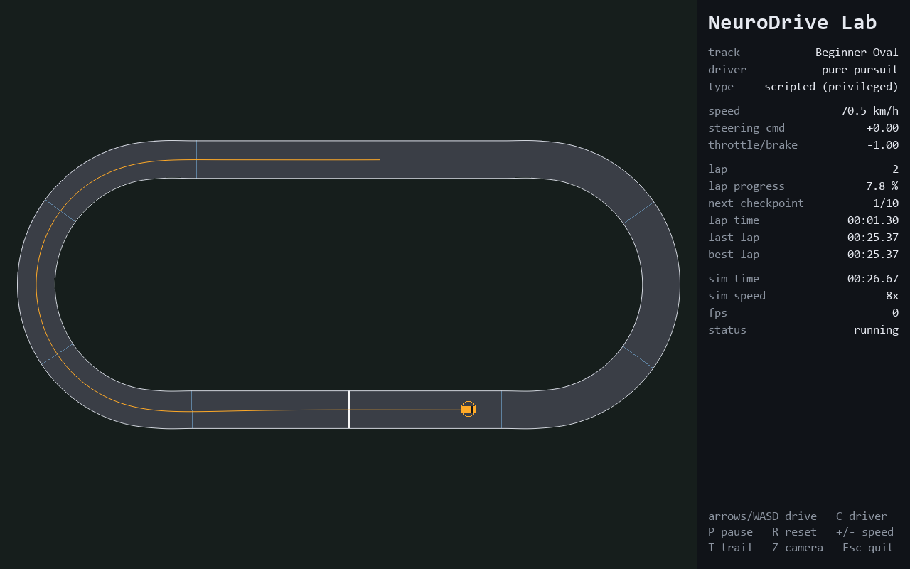

# NeuroDrive Lab

A 2D top-down driving simulator built as a controlled experiment: can a car learn to drive
by itself, and how do **reinforcement learning (PPO)** and **neuroevolution (NEAT)** compare
when they get the same car, sensors, tracks and budget?

> **Status: Phase 2 of 8: the learning environment and baselines.** The Gymnasium
> environment, sensors, reward and evaluation pipeline exist, with non-learning baseline
> drivers. **No agent has been trained yet** (PPO is Phase 3). See
> [the roadmap](docs/architecture-review.md#7-refined-roadmap-with-acceptance-criteria).



## What exists today

- Deterministic 2D car physics (kinematic bicycle model with steering rate and grip limits)
- Tracks defined as YAML files (centerline + width), validated on load
- Progress, ordered checkpoints, lap counting and lap timing that can't be cheated by
  shortcuts, reversing over the line or rocking over a gate
- Headless simulation and a throughput benchmark
- 9 raycast distance sensors and an 11-number observation vector
- A Gymnasium environment (`NeuroDrive-v0`) that passes the Gymnasium and
  Stable-Baselines3 checkers, with a reward designed against known exploits
- Baseline drivers: random, smoothed random, a sensors-only heuristic, and a
  privileged scripted autopilot
- An evaluator: fixed shared scenarios, one CSV row per episode, summaries with
  confidence intervals
- A pygame-ce playground: keyboard driving, baseline drivers, sensor-ray overlay, pause,
  0.25×–8× speed, follow camera
- 129 automated tests

Not built yet: PPO training, NEAT, replays, multiple tracks. See
[docs/architecture-review.md](docs/architecture-review.md).

## Install (Windows PowerShell)

Requires [uv](https://docs.astral.sh/uv/). uv downloads Python 3.12 if needed.

```powershell
git clone <this repo>
cd NeuroDrive-Lab
uv sync
```

## Quick start

```powershell
# Drive the car yourself (arrow keys / WASD)
uv run python -m neurodrive play

# Watch a baseline driver (press C in the window to cycle drivers, V for sensor rays)
uv run python -m neurodrive play --driver heuristic

# Evaluate a driver on 100 fixed validation scenarios (writes runs/eval/...)
uv run python -m neurodrive evaluate --controller heuristic --episodes 100

# Measure headless simulation speed
uv run python -m neurodrive bench-sim --steps 100000

# Check a track file
uv run python -m neurodrive validate-track beginner_oval
uv run python -m neurodrive list-tracks

# Tests and lint
uv run pytest
uv run ruff check .
```

### Playground controls

| Key | Action |
|---|---|
| Arrows / WASD | Steer, throttle, brake |
| C | Cycle driver: keyboard → heuristic → smoothed random → autopilot (none of these is AI) |
| V | Show/hide the distance-sensor rays |
| P | Pause / resume |
| R | Reset to the start line |
| + / − | Simulation speed 0.25× … 8× |
| Z | Camera: whole track ↔ follow the car |
| T | Show/hide the driven path |
| Esc | Quit |

A crash (any corner of the car leaving the track) ends the run; press R.

## Project layout

```
src/neurodrive/
  sim/          physics, tracks, sensors, progress, simulation (pure NumPy, no graphics)
  tracks/       track YAML files
  env/          Gymnasium environment: config, observations, rewards
  agents/       Controller interface and baseline drivers
  evaluation/   scenarios, evaluator, metrics
  experiments/  run metadata (versions, git commit)
  ui/           pygame-ce playground
  bench.py      headless throughput benchmark
  cli.py        python -m neurodrive ...
configs/        environment YAML
tests/          unit, integration, smoke
docs/           spec, architecture review, physics, measured results
```

## Documentation

- [docs/SPEC.md](docs/SPEC.md): the original project specification
- [docs/architecture-review.md](docs/architecture-review.md): Phase 0 design review and roadmap
- [docs/physics.md](docs/physics.md): how the car, track, collisions and laps work
- [docs/ml-guide.md](docs/ml-guide.md): the learning problem: observations, actions, reward, endings
- [docs/results.md](docs/results.md): measured numbers only, with commands
- [docs/phases/phase-1.md](docs/phases/phase-1.md), [docs/phases/phase-2.md](docs/phases/phase-2.md): phase reports

## License

Not chosen yet.
