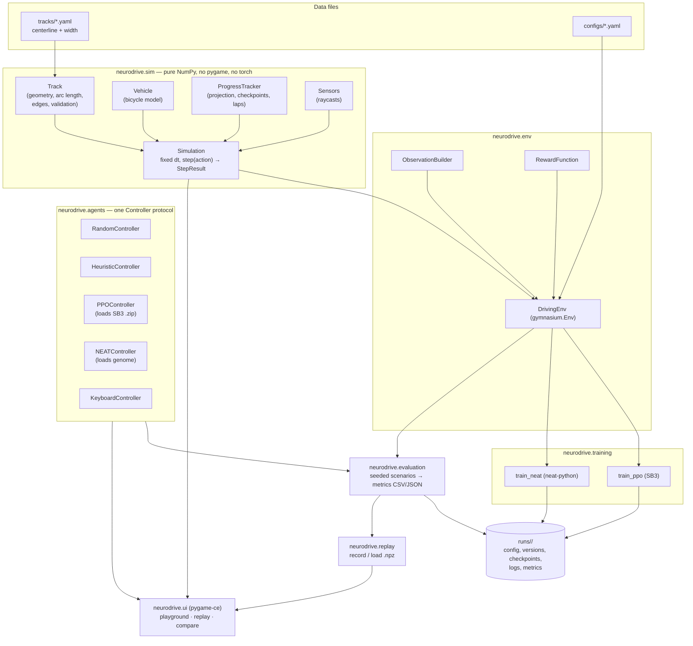

# NeuroDrive Lab — Architecture Review (Phase 0)

> Status: **proposal, awaiting approval.** No implementation code exists yet.
> Written against `docs/SPEC.md`. Date: 2026-11-20.
>
> Everything marked **[measured]** was actually run on the development laptop, with the
> command shown in [Appendix A](#appendix-a--what-was-actually-measured). Everything else
> is design reasoning. There are no training results, speed numbers, or benchmarks in this
> document, because none exist yet.

---

## 0. TL;DR

- The project is feasible on the laptop. The bottleneck will be **Python simulation speed
  on the CPU**, not the GPU. PPO with a small network should train on the **CPU**; the
  RTX 4070 is mostly irrelevant for v1. We will measure this, not assume it.
- The stack in the spec mostly holds up, with three changes:
  **pygame-ce instead of pygame**, **uv for environments and a lockfile**, and
  **Python 3.12** (not the 3.10 that is currently first on `PATH`).
- Biggest design recommendations:
  1. Represent every track as a **centerline + width**. Progress, collisions, checkpoints
     and lap validity all fall out of one projection onto that centerline.
  2. Reward = **signed progress along the centerline**, plus a lap bonus and a crash
     penalty. No checkpoint bonuses, no per-step time penalty (both are exploit magnets,
     explained in §5.4).
  3. NEAT fitness = **the same episode return PPO maximizes** (undiscounted). That makes
     the comparison much cleaner than inventing a second scoring rule.
  4. Default observation = **9 rays + speed + current steering angle** (11 numbers). Route
     features (heading error, lateral offset) become an *experiment toggle*, not the
     default.
  5. Cut the UI scope: a live "training viewer" should be **TensorBoard plus checkpoint
     replays**, not a live window attached to the trainer.
- The spec has one internal contradiction worth fixing now: it asks for "best-model
  selection on validation" in Phase 3, but there's only one track until Phase 5. §7 says
  how to handle that honestly.

---

## 1. Project understanding

What we're building, in one paragraph:

A **2D top-down driving simulator** written as a plain Python library that can run with no
window. On top of it sits a **Gymnasium environment** that turns the simulator into the
loop RL expects (observe → act → reward). Two completely different learners train against
that same environment: **PPO** (gradient-based RL, from Stable-Baselines3) and **NEAT**
(evolution of network weights *and* structure, from neat-python). Two non-learning
**baselines** (random and a hand-written heuristic) anchor the results. An **evaluation
harness** runs any controller under identical, seeded conditions and writes plain CSV/JSON.
A **pygame-ce viewer** lets a human drive, watch saved agents, replay recorded episodes and
compare checkpoints side by side.

The real product isn't the racing game. It's a **controlled experiment**: "given the same
car, sensors, track and budget, how do RL and neuroevolution differ?" The game is how you
make that experiment visible. That framing should drive the priorities: correctness of
the environment and evaluation first, visuals second.

Three things this project is *not*, and should resist becoming: a physics-accurate racing
sim, a UI framework project, or a hyperparameter-tuning contest.

---

## 2. Feasibility on this hardware

### 2.1 What the machine is [measured]

| Item | Value |
|---|---|
| CPU | 13th Gen Intel Core i9-13900HX, 24 cores / 32 threads (8 performance + 16 efficiency cores) |
| RAM | 31.7 GB visible to Windows |
| GPU | NVIDIA GeForce RTX 4070 Laptop GPU, 8188 MiB, driver 581.80 (nvidia-smi reports "CUDA Version: 13.0") |
| Pythons installed | 3.10.11 (first on `PATH`), 3.11, 3.12, 3.13 (default for the `py` launcher) |
| Tools | uv 0.11.19, git 2.54.0 |

### 2.2 Where the time will go (reasoning, to be confirmed by profiling)

One training step involves: advance the car physics, check collisions, cast 9 rays against
the track edges, compute progress, compute reward, then run the policy network once.

- **Physics + collisions + progress:** a handful of floating-point operations. Cheap, but in
  pure Python every operation carries interpreter overhead.
- **Raycasting:** this is the expensive part. 9 rays × (number of boundary segments). A
  track might have a few hundred boundary segments. Done naively in Python loops, this will
  dominate. Done as one vectorized NumPy operation (all rays vs. all nearby segments at
  once), it should be fine. Restricting candidate segments to a window around the car's
  current position on the centerline makes it cheaper still.
- **Policy network:** an MLP with two hidden layers of 64 units is ~5,000 parameters. On a
  CPU that is microseconds. Moving it to the GPU adds a CPU→GPU→CPU copy every step,
  which likely costs more than the math saves.

So the expected bottleneck is **Python environment stepping on the CPU**. Stable-Baselines3
itself emits a warning when you put an MLP-policy PPO on the GPU, for this reason. The
spec already anticipates this (§4: "do not assume the RTX 4070 is the bottleneck"). We
will confirm it by measuring steps/second with CPU vs. CUDA once, as an experiment, and
recording the result.

### 2.3 Where parallelism helps

- **PPO:** SB3 can run N copies of the environment. `DummyVecEnv` runs them in one process
  (no overhead, no true parallelism). `SubprocVecEnv` uses separate processes. On Windows,
  processes start with *spawn* (a fresh interpreter that re-imports everything), so
  start-up and inter-process traffic are expensive. For a cheap environment, `DummyVecEnv`
  can win. **We measure both.**
- **NEAT:** this is where the 24 cores pay off. Each genome's evaluation episode is
  independent, so `neat.ParallelEvaluator` (process pool) can evaluate the population in
  parallel. Same Windows caveat: needs a `if __name__ == "__main__":` guard and picklable
  evaluation functions.
- **Laptop caveat:** wall-clock numbers will vary with power mode, charger, and thermal
  throttling, and Windows may put work on efficiency cores. Every benchmark must record
  the power state and be run plugged in. This matters for the "training wall-clock time"
  metric in §12.

### 2.4 Graphics

A 2D top-down view with a few hundred line segments and some cars is trivial for
pygame-ce at 60 FPS. The only rule that matters: **the trainer never renders.** The viewer
is a separate process that loads checkpoints or replay files.

### 2.5 The GPU's actual role

For v1: none required. Everything works CPU-only, which also makes CI and other people's
laptops simpler. The GPU becomes useful if we later add pixel/vision observations with a
CNN (spec §25). One measured GPU-vs-CPU comparison in Phase 3 is still worth doing, because
it's an honest, interview-friendly result.

CUDA note [measured]: the PyTorch index lists torch 2.15.0 Windows CUDA wheels built for
CUDA 13.2 (`cu132`); the newest `cu130` build is 2.14.1. The installed driver reports CUDA
13.0. I have **not** tested whether the cu132 build runs on this driver. If we want the GPU
experiment, either update the NVIDIA driver or pin `torch==2.14.1+cu130`. Since the default
is CPU, this blocks nothing.

---

## 3. Technology selection

Versions are the latest on PyPI as of 2026-11-20 [measured]. A scratch venv with all of
these installed and imported cleanly on this laptop, a headless pygame-ce window opened,
and a 128-step SB3 PPO run completed [measured]. That proves installability, nothing more.

| Purpose | Choice | Version checked | Verdict |
|---|---|---|---|
| Language | **Python 3.12** | 3.12.13 (the interpreter uv selected) | **Changed** — see below |
| Env/deps | **uv** + `pyproject.toml` + `uv.lock` | uv 0.11.19 | **Added** |
| Numerics | NumPy | 2.5.5 (needs Python ≥ 3.12) | Keep |
| RL env API | Gymnasium | 1.4.0 | Keep |
| PPO | Stable-Baselines3 | 2.9.2 (needs torch ≥ 2.8, gymnasium < 2) | Keep |
| NN backend | PyTorch, **CPU build by default** | 2.15.0+cpu | Keep, CPU default |
| Neuroevolution | neat-python | 2.0.0 (PyPI); GitHub also has a v2.0.1 tag | Keep |
| Renderer | **pygame-ce** | 2.5.8 | **Changed** from pygame |
| Config | YAML (PyYAML 6.0.3) + **pydantic 2** models | 2.14.4 | **Added** pydantic |
| Tracking | TensorBoard | 2.21.0 | Keep |
| Plots/tables | Matplotlib, pandas | 3.11.2, 3.1.1 | Keep |
| Tests/lint | pytest, Ruff, mypy (non-blocking at first) | 9.2.0, 0.17.6, 2.4.1 | Keep |
| CI | GitHub Actions (windows-latest + ubuntu-latest) | — | Keep |

### Why each change

**Python 3.12, not 3.10 or 3.13.** NumPy 2.5 requires ≥ 3.12, and PyTorch 2.15 and pandas 3
require ≥ 3.11, so 3.10 is out. (Careful: `python` on this machine's `PATH` is 3.10.11.
Using it would silently resolve older libraries. uv pins the interpreter so this can't
happen by accident.) SB3 2.9.2 declares support up to 3.13, so 3.13 would also work. I pick
3.12 as the conservative default and test 3.13 in CI. `requires-python = ">=3.12,<3.14"`.

**pygame-ce instead of pygame.** The original `pygame` last released 2.6.1 in September 2024
and ships no wheels for Python 3.14+. `pygame-ce` (community edition) is actively released
(2.5.8, August 2026), has wheels through 3.15, and is what both Gymnasium and SB3 now list
in their extras. Same `import pygame`, so code and tutorials still apply. **Never install
both**; they clash on the import name. This also means we avoid `neat-python[examples]`,
which pulls in plain `pygame`.

**uv.** It's already installed, it pins the Python version, and it produces a lockfile.
That lockfile is what makes "someone clones the repo and gets the same libraries"
(spec §13) actually true. It can also be told to fetch PyTorch from the CPU wheel index,
so a fresh install doesn't download a ~2 GB CUDA build nobody needs. Plain `pip install -e .`
stays possible for people who don't use uv.

**pydantic for configs.** The spec wants "actionable error messages" for bad configs. A
pydantic model per config section gives you "`ppo.learning_rate`: must be > 0, got -1"
for free and documents every field in one place. It's one small, standard dependency.
The alternative (dataclasses + hand-written checks) is fine too, but more code for worse
messages.

### Things considered and rejected for v1

- **Godot/Unity:** rejected for v1, as the spec suggests. They'd split the project across two
  languages and a network bridge, for visuals the project doesn't need yet.
- **Shapely** (geometry library): not needed. Our geometry is segments and polylines, and
  a few NumPy functions are easier to test and explain.
- **Numba / C extensions:** only if profiling shows raycasting is the bottleneck *after*
  NumPy vectorization. Kept in reserve.
- **graphviz** for drawing NEAT networks: the neat-python examples use it, but on Windows it
  needs a separately installed system binary. We'll draw topologies ourselves
  (matplotlib or pygame), which also gives us control over layout.
- **JAX-based neuroevolution (evosax, etc.):** fast, but JAX on native Windows is a known
  pain and it would require rewriting the simulator in JAX. No.
- **Weights & Biases / MLflow:** violates "no paid/external services" or is too heavy.
  TensorBoard + CSV/JSON is enough.

### Library facts that shape the design

- **Gymnasium 1.x API:** `reset(seed=..., options=...) -> (obs, info)`;
  `step(action) -> (obs, reward, terminated, truncated, info)`. `terminated` and
  `truncated` are different on purpose (§5.5).
- **SB3** validates environments with `stable_baselines3.common.env_checker.check_env`,
  and Gymnasium has its own checker. We run both in tests.
- **SB3 action handling:** PPO's continuous policy samples from a Gaussian and the
  environment receives the action **clipped** to the action space bounds. We clamp again
  inside the environment anyway (defense in depth, and NEAT needs it too).
- **neat-python 2.0:** the breaking change in 2.0 only affects CTRNN networks. We use
  feed-forward networks, which are unchanged. Since 1.1 it supports a `seed` in the
  config / `Population(...)` / `ParallelEvaluator(...)` for reproducible evolution, which
  we need.

---

## 4. Architecture proposal

### 4.1 Layers and data flow



### 4.2 The rules that keep this clean

1. **`sim` imports nothing from the rest of the project**, and never imports pygame or torch.
   It's testable on its own and runs headless by construction.
2. **`env` is the only place that knows about rewards and observations.** PPO, NEAT, the
   baselines, and the evaluator all go through it. Training code never touches physics.
3. **One `Controller` protocol** for everything that drives:
   `reset(seed) -> None` and `act(obs: np.ndarray) -> np.ndarray[2]`.
   A trained PPO model and a NEAT genome both become plain Controllers after loading,
   so the evaluator, the viewer, and the replay recorder don't care which algorithm
   made them. This is the mechanism behind "both learning approaches use equivalent
   interfaces" (spec §23).
4. **The UI is a consumer only.** It reads tracks, controllers and replay files; it is never
   in the training loop.
5. **No global state.** Each `Simulation` gets its own `numpy.random.Generator` from a seed.
   No module-level RNG, no singletons.
6. **Saved models are self-describing.** Every checkpoint sits next to a `metadata.json`
   (algorithm, observation spec version, action spec, track, seeds, library versions,
   git commit). Loading a model checks the observation spec matches and fails loudly if
   not. This prevents the classic silent bug of loading a model trained on 11 inputs into
   an env producing 13.

### 4.3 Core interfaces (draft — will be finalized in code with tests)

```python
# sim
@dataclass(frozen=True)
class VehicleParams:      # meters, seconds, radians
    wheelbase: float; length: float; width: float
    max_speed: float; max_accel: float; max_brake: float
    max_steer: float; steer_rate: float; drag: float; rolling_resistance: float

@dataclass
class VehicleState:
    x: float; y: float; heading: float; speed: float; steer: float

class Track:              # loaded from file, immutable after load
    track_id: str; centerline: np.ndarray  # (N, 2), uniform arc-length spacing
    half_width: np.ndarray                 # (N,)
    left_edge: np.ndarray; right_edge: np.ndarray
    length: float; start_pose: tuple[float, float, float]
    checkpoint_s: np.ndarray               # arc-length positions of gates
    def project(self, p, hint_idx) -> Projection  # s, lateral offset, segment index

class Simulation:
    def __init__(self, track: Track, params: SimConfig, seed: int | None): ...
    def reset(self, seed: int | None = None, start_perturbation: bool = False) -> None
    def step(self, action: np.ndarray) -> StepResult  # exactly one fixed dt
    # StepResult: state, progress delta, crossed checkpoint?, lap completed?,
    #             collided?, termination reason

# agents
class Controller(Protocol):
    name: str; kind: Literal["human", "random", "heuristic", "ppo", "neat"]
    def reset(self, seed: int | None) -> None: ...
    def act(self, obs: np.ndarray) -> np.ndarray: ...
```

---

## 5. ML design

### 5.1 Vehicle model (spec §6.2)

Kinematic bicycle model. State `(x, y, heading ψ, speed v, steering angle δ)`.

- Steering command `u_s ∈ [-1, 1]` → target angle `δ* = u_s · δ_max`. The actual δ moves
  toward δ* at a limited rate (`steer_rate`). This means steering takes a moment to turn,
  which is more realistic and makes jittery policies visibly worse.
- Longitudinal command `u_a ∈ [-1, 1]`: positive = throttle `u_a · a_max`, negative = brake
  `|u_a| · b_max`. Drag `c·v²` plus a small rolling resistance. Speed clamped to
  `[0, v_max]`: **no reverse**.
- Heading rate `ψ̇ = v / L · tan δ`. Because `ψ̇` is proportional to `v`, **the car cannot
  spin in place at zero speed** — required by the spec, and it comes free from the model.
- Optional (config flag, off by default): reduce the usable steering angle at high speed
  as a crude stand-in for grip limits.
- Units are SI (meters, m/s). Rendering converts meters → pixels. Never mix pixels into
  physics.
- Integration: semi-implicit Euler at `dt = 1/30 s`, with a fixed number of physics
  sub-steps (e.g. 2–4) per decision step so fast cars can't tunnel through a wall between
  checks. Sub-steps are fixed per config, so determinism is unaffected.

### 5.2 Track representation and collisions (spec §6.3–6.4)

**Recommendation: every track is a closed centerline + a width.** Authored as a list of
control points in a YAML file, smoothed with a closed Catmull-Rom spline, then resampled
to evenly spaced points (e.g. every 0.5 m). From that:

- **Edges** = centerline offset left/right by the half-width. These are what rays hit and
  what the renderer draws.
- **Progress** `s` = arc length of the car's projection onto the centerline.
- **Collision** = any of the car's 4 rectangle corners has `|lateral offset| > half_width`.
  That's an oriented-rectangle hitbox checked against an exactly defined drivable
  corridor, and it costs 4 projections.
- **Checkpoints** = gates at fixed arc-length intervals (e.g. every 10% of the lap),
  derived automatically, not hand-placed.

Why this beats free-form boundary polygons for v1:

| | Centerline + width | Arbitrary boundary polygons |
|---|---|---|
| Progress | Free (arc length) | Needs a separate centerline anyway |
| Collision | 4 projections | Point-in-polygon or segment tests |
| Anti-shortcut | Built in (see below) | Needs careful checkpoint placement |
| Validation | Simple checks | Hard (self-intersection etc.) |
| Expressiveness | Corridor tracks only | Anything |

Corridor-only is the cost, and it's fine for racing circuits.

**The projection trick that stops shortcuts.** Project the car only onto centerline
points within a small window around where it was last step (`hint_idx`), not onto the
whole track. On a hairpin, the nearest centerline point could jump to the other side of
the infield; the window prevents that, so the car's progress can only move continuously.
Driving through the infield is a collision anyway, so it can't be used to "teleport"
progress.

**Track validation** (run when loading and in tests): the loop closes; the two edges don't
self-intersect; the minimum turn radius is larger than the half-width (otherwise the inner
edge folds over itself); the start pose is on track; and a simple heuristic driver can
complete a lap (proves the track is drivable).

### 5.3 Observation vector (spec §7)

**Default: 11 numbers, all from the car's own point of view.**

| # | Feature | Normalization | Range |
|---|---|---|---|
| 0–8 | Ray distances at -90°, -60°, -40°, -20°, 0°, +20°, +40°, +60°, +90° | `d / max_range`, clipped | [0, 1] |
| 9 | Speed | `v / v_max` | [0, 1] |
| 10 | Current steering angle | `δ / δ_max` | [-1, 1] |

Why the steering angle is in there: because steering has a rate limit (§5.1), the current
angle is part of the car's state. Without it, the agent can't know whether the wheels are
already turned, which breaks the "the observation tells you what you need" property RL
assumes (the Markov property).

**What I'm challenging in the spec:** the spec lists heading error and lateral offset as
candidate inputs. Those are *privileged* — the car doesn't sense them, the simulator
computes them from the route. They make learning easier, but:

1. The side rays already encode lateral offset and, roughly, heading relative to the walls.
2. They make the heuristic baseline nearly perfect, which makes ML look less impressive
   than it is.
3. Agents that lean on them may generalize worse to new tracks.

So: **default = sensors only**. Add a `route_features: true` option that appends heading
error (as `sin` and `cos` of the angle to the track tangent ahead) and normalized lateral
offset, clearly labeled privileged. Comparing the two is a ready-made experiment ("does
privileged information help, and does it hurt generalization?"). If sensors-only fails to
learn on the oval, that's a measured finding and we turn route features on.

Guarantees, each with a test: fixed shape `(11,)` / dtype `float32`; fixed order; no
NaN/Inf; values inside the declared `Box` bounds; deterministic for a given state; rays
hitting exactly at max range or starting at a wall behave correctly.

### 5.4 Action space (spec §8)

As specified: `Box(low=-1, high=1, shape=(2,), dtype=float32)` = `[steering, throttle/brake]`.
Agree with it. Combined throttle/brake on one axis is good: the agent can't press both at
once.

- PPO: Gaussian policy, actions clipped to the box by SB3, clamped again by the env.
- NEAT: two output nodes with `tanh` activation, so outputs are naturally in [-1, 1].
- Both go through the exact same `env.step()` and the same vehicle model.

### 5.5 Reward, termination and truncation (spec §9.3)

**Proposed reward per step:**

```
r = k_progress · Δs              # signed progress along the centerline, in meters
  + k_lap      · [lap completed]  # one-time bonus, ends the episode
  − k_crash    · [collision]      # ends the episode
  − k_crash    · [stalled]        # no net progress for T seconds; ends the episode
```

`Δs` is computed with wrap-around at the start line (the change is taken modulo the lap
length into `(-L/2, L/2]`) and clipped to what's physically possible in one step.

Why this shape, and what each rule prevents:

| Failure mode from the spec | What stops it |
|---|---|
| Stand still forever | "Stalled" ends the episode with the crash penalty, so standing still is never better than trying |
| Oscillate forward/back for reward | Progress is **signed**: going back 1 m costs exactly what going forward 1 m earned. Net zero at best |
| Re-farm the same checkpoint | No checkpoint rewards at all. Checkpoints are only used to validate laps |
| Cut across the infield | It's a collision. Plus the windowed projection (§5.2) |
| Cross the start line backwards to "complete" a lap | A lap counts only if all checkpoints were passed in order since the last lap |
| Drive forever without finishing | Episode time limit → truncation. Lap bonus + discounting reward finishing sooner |
| Drive into walls | Crash ends the episode and forfeits all future progress |

**Two traps I'm deliberately avoiding:**

1. **A per-step time penalty** (a common suggestion, "−0.01 every step to encourage
   speed"). If the crash penalty isn't large enough, the agent learns that crashing
   *early* stops the bleeding — the AI learns to commit suicide. Progress reward already
   rewards speed (more meters per second = more reward per second), so a time penalty
   isn't needed.
2. **Checkpoint bonuses.** Big lumps of reward at gates create local exploits (e.g.
   hovering around a gate if the crossing logic is loose) and make the reward hard to
   reason about. Continuous progress gives the same signal smoothly.

**Termination vs. truncation** (this matters for PPO's math):

- `terminated = True` when the episode *genuinely ended*: crash, stall, or lap completed.
  The future value is zero.
- `truncated = True` when we *cut it off* for time. The car could have kept going, so PPO
  should still estimate future value from that state ("bootstrapping"). Mixing these up
  is a classic, silent bug: it teaches the agent that running out of time is like
  crashing.

**Episode definition (v1):** start from the start pose (with optional small seeded
perturbation), drive **one lap**; success = lap completed within the time limit. One lap from
a standing start gives a clean, comparable lap time. Multi-lap episodes are a config option
for later.

All coefficients live in config and get recorded with each run. Starting values get
picked in Phase 2 by running the baselines and checking the reward scale, not now.

### 5.6 PPO setup (spec §9)

- SB3 `PPO("MlpPolicy")`, SB3 defaults first (network 64×64, `lr=3e-4`, `n_steps=2048`,
  `batch_size=64`, `gamma=0.99`, `gae_lambda=0.95`, `clip_range=0.2`). Change things only
  for measured reasons, and record every change.
- `n_envs` = 8 to start, `DummyVecEnv` vs `SubprocVecEnv` decided by measurement.
- CPU device by default, `--device cuda` available.
- Callbacks: periodic evaluation (deterministic policy) on validation scenarios, best-model
  saving, checkpointing every N steps (these are what the "learning timeline" feature
  replays), custom TensorBoard scalars (lap rate, collision rate, mean progress, mean speed).
- Diagnostics to log and explain: entropy (how random the policy still is), policy loss,
  value loss, approx KL (how much each update changed the policy), clip fraction,
  explained variance (how well the critic predicts returns).

### 5.7 NEAT setup (spec §10)

- 11 inputs, 2 `tanh` outputs, feed-forward only, start fully connected with **no hidden
  nodes**. NEAT adds hidden nodes and connections over generations. Watching a network
  grow from 22 connections is the visual payoff.
- Population ~150 to start (config). Speciation, elitism, crossover and mutation are
  neat-python's own.
- **Fitness = the undiscounted episode return of the exact same reward function.**
  The spec allows a different fitness scale. I recommend against it: if PPO and NEAT
  optimize *different* objectives, any difference in outcome could come from the
  objective, not the algorithm. Same objective, different optimizer = cleaner experiment.
  (An alternative fitness can be a later experiment.)
- **Common random numbers:** within one generation, every genome is evaluated on the *same*
  seeded start scenario(s). Otherwise a genome can win just by getting an easy start.
  Evaluating each genome on 2–3 starts reduces luck at a proportional cost in steps.
- Every environment step every genome takes counts toward NEAT's step budget. This will
  add up fast: purely as arithmetic, 150 genomes × a 900-step episode = 135,000 steps per
  generation. That's exactly why budgets must be compared in environment steps (§6).
- Seeded via neat-python's `seed` support; evaluation parallelized with `ParallelEvaluator`
  once the serial version is tested.

### 5.8 Baseline controllers (spec §11)

1. **Random** — two flavors: uniform random each step, and "smoothed random" (hold or
   low-pass-filter actions over several steps). The smoothed one is the fairer baseline,
   because pure noise just vibrates in place.
2. **Heuristic (sensors-only)** — uses *only* the same 11 inputs the agents get: steer
   toward the side with more space (difference of left vs. right rays), throttle by front
   ray distance. Answers "how far can simple logic get with this information?"
3. **Heuristic (privileged pure-pursuit)** — follows the centerline using simulator
   knowledge. Explicitly labeled *privileged / not comparable*. Its job is to prove each
   track is drivable and to provide a rough "good driving" reference lap time.

All baselines are labeled as non-ML everywhere they appear in the UI and reports.

---

## 6. Evaluation methodology — avoiding a misleading PPO-vs-NEAT comparison

The ways this kind of comparison usually goes wrong, and the fix for each:

1. **Deterministic sim → fake sample size.** If the simulator is deterministic and the
   policy is deterministic, 100 evaluation episodes from the same start are *one*
   episode repeated 100 times. **Fix:** every evaluation scenario = a seeded start
   perturbation (small changes to position along the start straight, lateral offset,
   heading). A fixed list of e.g. 50 scenario seeds per track is shared by every
   controller.
2. **Comparing iterations.** "100 NEAT generations vs 1M PPO steps" means nothing.
   **Fix:** the x-axis is always environment steps (and separately, wall-clock). Both
   algorithms get the same step budget, and learning curves are plotted against steps.
3. **Cherry-picked seeds.** One lucky PPO seed vs one unlucky NEAT seed. **Fix:** ≥3
   independent training seeds per algorithm (5 if compute allows), all reported, including
   failures. Show every seed's curve, not just the mean.
4. **Selecting on the test set.** Picking the "best checkpoint" by its score on the
   held-out track makes the held-out score meaningless. **Fix:** strict
   train / validation / test separation. Checkpoint and hyperparameter selection use
   validation only. Test tracks are evaluated once, at the end.
5. **Hiding failures in lap time.** Averaging lap time over successful laps only can make
   a policy that finishes 10% of the time look fast. **Fix:** always report completion rate
   next to lap time, plus the number of episodes. Lap time stats are labeled "over N
   completed laps out of M".
6. **Unequal tuning effort.** If we tune PPO for a week and NEAT for an hour, we've measured
   our effort. **Fix:** record how many configurations were tried for each and report it.
7. **Stochastic vs deterministic policies.** PPO evaluated with sampling noise vs NEAT's
   deterministic net is unfair to PPO. **Fix:** evaluate PPO deterministically (the
   policy's mean action), and say so.
8. **Overclaiming.** With 3 seeds, "PPO is better" is rarely supportable. **Fix:** report
   means with bootstrap 95% confidence intervals across seeds, and Wilson intervals for
   completion rates. Wording follows the data: "with 3 seeds we can't distinguish them"
   is a valid conclusion.

**Track split (target by Phase 5):** training tracks, one validation track, two held-out
test tracks, as the spec says. Two additions:

- **Include both driving directions.** If every training track is counter-clockwise, the
  agent may only learn to turn left well. Mirrored tracks are cheap and give a clean
  overfitting demonstration.
- **Consider a simple procedural generator in Phase 5** (random bumps on a circle's radius,
  then smoothing). Shapes like that can't self-intersect by construction, and it turns
  "2 test tracks" (a very small sample for generalization claims) into "50 random test
  tracks". The spec lists procedural generation as optional; I think this specific
  simple version earns its place in Phase 5.

Every evaluation writes one row per episode to CSV (controller, checkpoint, track,
scenario seed, completed, lap time, progress, collision, steps, mean speed, termination
reason). Every aggregate and chart is computed from those rows, so nothing in a report
can exist without a per-episode record behind it.

---

## 7. Refined roadmap with acceptance criteria

Changes from the spec: Phase 1 includes the track file format and validator (so Phase 5
doesn't need a rewrite) and the first measured speed number. Phase 3 defines
"validation" honestly. Phase 7 scope is cut. Each phase ends with the mentoring write-up
from spec §21.

### Phase 1 — Driving simulator (no ML)
See §10 for the full task list.
**Done when:** a human can drive a lap with the keyboard; collisions end the run; laps only
count when valid; the sim runs headless; determinism and physics tests pass on Windows; a
measured headless steps/second number is recorded.

### Phase 2 — Environment and baselines
Raycasts (vectorized), observation builder, reward, termination/truncation, `DrivingEnv`,
random + heuristic controllers, ray-debug overlay, evaluator v1 (CSV per episode).
**Done when:**
- Gymnasium and SB3 env checkers pass in tests.
- 1,000 random-action episodes run headless with no NaN/Inf/out-of-bounds observations.
- Exploit tests pass: oscillating forward/back nets ≤ 0 reward; reversing across the
  line never counts a lap; standing still terminates as stalled; the infield shortcut
  is a collision.
- The sensors-only heuristic and pure-pursuit baselines are evaluated on the oval, and their
  real numbers are recorded as the first table in `docs/results.md`.

### Phase 3 — PPO
Training CLI, config, seeding, callbacks, checkpoints, TensorBoard, `PPOController`, save/load.
Validation in this phase = **the same oval with a separate set of perturbed starting
scenarios** (different seeds from the test set). That's state-level validation, not
geometry-level, and gets labeled as such. Geometric validation arrives in Phase 5.
**Done when:**
- A smoke run (~10k steps) completes in CI-sized time and its checkpoint loads and drives.
- A full run on the oval is compared against random and heuristic on the shared
  scenario set. Improvement, if any, is shown with numbers. If PPO doesn't learn, we
  diagnose before moving on.
- One measured CPU vs CUDA throughput comparison is recorded.

### Phase 4 — NEAT
Training CLI, neat config, shared fitness, generation stats CSV, champion + generation
checkpoints, `NEATController`, topology drawing.
**Done when:** multiple generations run; a champion saves, loads, and drives in the viewer;
two runs with the same seed produce the same fitness history (serial evaluation); NEAT
is evaluated on the same scenario set as PPO.

### Phase 5 — Multiple tracks and generalization
Additional tracks (both directions), validation and test tracks, optional procedural
generator, multi-track training (track sampled per episode), test-set tooling that refuses
to be used for model selection.
**Done when:** track changes need no code changes; test tracks are excluded from training
by construction (checked in code, not just by convention); a generalization table exists,
including overfitting if it happens.

### Phase 6 — Benchmark
≥3 seeds × {PPO, NEAT} under a matched step budget, plus baselines; aggregate script; charts;
`docs/results.md` with methods, numbers, confidence intervals, compute cost, and limitations.
**Done when:** the whole report regenerates from `runs/` with one command; failed seeds
appear; every claim cites a table.

### Phase 7 — Interactive lab (scoped down)
**v1 UI = four screens:** Playground (drive, pick a controller, rays on/off, speed control,
pause), Replay viewer, Side-by-side comparison (ghost cars — no car-to-car collisions),
and Learning timeline (checkpoints from the same run raced as ghosts). Network topology
panel for NEAT and a static architecture diagram for PPO. Learning curves are matplotlib
images or TensorBoard, **not** live charts drawn in pygame.
**Not in v1:** a live training viewer attached to the trainer, a menu system beyond simple
screen switching, real-time charting inside pygame.
**Done when:** a new user can launch each screen from the README commands; every car on screen
is labeled with its controller type; demos run at a steady frame rate with measured FPS.

### Phase 8 — Release
README with real GIFs and real results, install guide (PowerShell), troubleshooting, CI green
on Windows and Linux, license chosen, no large files committed.

---

## 8. Risks

| Risk | Likelihood | Impact | Mitigation |
|---|---|---|---|
| Python sim too slow for big training budgets | Medium | High | Vectorized raycasts, windowed segment search, profile first; Numba only if profiling demands it |
| PPO doesn't learn with sensors-only obs | Medium | Medium | Heuristic baseline proves the info is sufficient; route-features toggle; reward-scale checks |
| Reward exploit found by the agent | High (it always happens) | Medium | Exploit tests in Phase 2; watch replays, not just curves; termination reasons logged |
| terminated/truncated confusion | Medium | Medium | Explicit unit tests on each termination reason |
| NEAT consumes far more env steps than PPO | High | Medium | Expected. Compare at matched step budgets *and* report each at its natural budget, clearly labeled |
| Windows multiprocessing (spawn) slow/fragile | Medium | Medium | Serial first; `__main__` guards; measure Dummy vs Subproc; set torch threads = 1 in workers |
| Too few tracks for generalization claims | High | Medium | Mirrored tracks; simple procedural generator; cautious wording |
| Laptop thermals distort wall-clock | High | Low–Med | Record power mode and plugged-in state; compare steps, not seconds, as the primary axis |
| Cross-run nondeterminism (threads, BLAS, multiprocessing order) | Medium | Low | Seeds everywhere; document "same machine, same seed, serial → identical"; don't promise bitwise reproducibility across machines |
| `pygame` and `pygame-ce` both installed | Low | Medium | Only `pygame-ce` in deps; a startup check |
| CUDA wheel/driver mismatch | Medium | Low | CPU default; documented GPU install path |
| Scope creep (UI, extra algorithms, extensions) | High | High | Phase gates; §24 restrictions; Phase 7 scope cut above |
| Large checkpoints committed | Medium | Low | `runs/` is git-ignored; only small curated results committed |

---

## 9. Repository structure

Adapted from spec §16. Main differences: tracks are *data files* inside the package;
`physics.py` folds into `vehicle.py` (they'd be one concept split in two); collision
logic lives with track geometry; outputs go to a git-ignored `runs/`; `results/` holds
only small, curated, committed summaries. Files appear when their phase needs them.

```
NeuroDrive-Lab/
├── pyproject.toml            # deps, ruff/pytest/mypy config, CPU torch index for uv
├── uv.lock
├── README.md
├── LICENSE
├── .gitignore                # runs/, .venv/, __pycache__, *.zip checkpoints, tb logs
├── .github/workflows/ci.yml  # ruff + pytest on windows-latest & ubuntu-latest, py3.12/3.13
├── configs/
│   ├── sim/default.yaml
│   ├── ppo/default.yaml
│   ├── neat/default.ini      # neat-python's own config format
│   └── experiments/          # named experiments composing the above
├── src/neurodrive/
│   ├── __main__.py           # python -m neurodrive ...
│   ├── cli.py
│   ├── sim/
│   │   ├── geometry.py       # vectors, segment intersection, polyline projection
│   │   ├── track.py          # Track, loading, spline resampling, validation
│   │   ├── vehicle.py        # VehicleParams, VehicleState, bicycle step
│   │   ├── progress.py       # ProgressTracker: s, checkpoints, laps, lap timer
│   │   ├── sensors.py        # vectorized raycasts             (Phase 2)
│   │   └── simulation.py     # Simulation: fixed-dt step, collisions, termination
│   ├── tracks/               # *.yaml track definitions (package data)
│   ├── env/                  # driving_env.py, observations.py, rewards.py  (Phase 2)
│   ├── agents/               # base.py (Controller), keyboard, random, heuristic, ppo, neat
│   ├── training/             # ppo.py, neat.py, callbacks.py   (Phases 3–4)
│   ├── evaluation/           # scenarios.py, evaluator.py, metrics.py, report.py
│   ├── experiments/          # config models (pydantic), run dirs, metadata/versions
│   ├── replay/               # record/load .npz + metadata
│   └── ui/                   # app.py, renderer.py, hud.py, screens/
├── tests/
│   ├── unit/
│   ├── integration/
│   └── smoke/
├── docs/
│   ├── SPEC.md
│   ├── architecture-review.md   # this file
│   ├── architecture.md          # living version once code exists
│   ├── physics.md · ml-guide.md · training-guide.md · results.md
├── results/                  # small committed summaries & figures only
└── runs/                     # git-ignored experiment outputs
```

---

## 10. First implementation milestone — Phase 1, concretely

Goal: a deterministic, tested, drivable simulator. No ML, no Gymnasium yet.

**Tasks (in order, each a small reviewable commit):**

1. **Scaffold.** `pyproject.toml` (Python 3.12, uv, CPU torch index declared for later,
   but Phase 1 deps only: numpy, pyyaml, pydantic, pygame-ce; dev: pytest, ruff, mypy),
   `.gitignore`, minimal README, CI workflow running ruff + pytest on Windows and Linux.
2. **Geometry.** `geometry.py`: segment–segment intersection, point–polyline projection
   with a search window, closed Catmull-Rom resampling at uniform arc length. Unit tests
   with hand-computable cases (squares, circles).
3. **Track.** YAML format (`id`, `control_points`, `width`, `start` (arc-length position or pose),
   `direction`, `checkpoint_count`), loader, edge generation, `validate()`
   (closure, no edge self-intersection, min radius > half-width, start on track).
   Ship `beginner_oval.yaml`. Tests: oval length ≈ analytic value, validator rejects a
   deliberately broken track.
4. **Vehicle.** Params + state + `step(state, action, dt)`. Tests: zero speed + full steer
   → heading unchanged; throttle increases speed up to `v_max` and no further; brake never
   makes speed negative; positive steer turns the agreed direction; steering rate limit
   respected; actions outside [-1, 1] are clamped.
5. **Progress tracker.** Arc-length progress with windowed projection, wrap-around at the
   line, ordered checkpoints, lap counting, lap timer in sim time. Tests: a scripted
   centerline drive completes exactly 1 lap; driving backwards across the line counts no lap;
   skipping a checkpoint invalidates the lap; progress delta is continuous across the line.
6. **Simulation.** Fixed `dt = 1/30` with fixed sub-steps, collision via 4 corners,
   termination reasons (`collision`, `lap_complete`, `time_limit`), `reset(seed,
   perturb)`. Tests: **determinism** (same seed + same action sequence → identical
   trajectory, compared exactly); a car pushed into a wall reports a collision; 10k
   headless steps with no display available.
7. **Headless benchmark.** `python -m neurodrive bench-sim --steps 100000` prints measured
   steps/second plus Python/NumPy versions. The first real performance number, recorded
   in `docs/results.md` with the exact command.
8. **Viewer.** pygame-ce window: track, car, start line, checkpoints, HUD (speed, lap,
   current/last lap time, progress %, last termination reason). Fixed-timestep loop with
   an accumulator, so physics advances by exactly `dt` regardless of frame rate. Controls:
   arrows/WASD, `P` pause, `R` reset, `+/-` sim speed (0.25×–8×), `Esc` quit.
9. **CLI.** `python -m neurodrive play --track beginner_oval`, `bench-sim`,
   `validate-track PATH`. Bad inputs produce one clear sentence, not a stack trace.
10. **Docs + review.** `docs/physics.md` (bicycle model in plain language, with a diagram),
    README quick start (PowerShell), and the spec §21 phase write-up.

**Phase 1 acceptance checklist:**

- [ ] `uv sync` then `uv run pytest` passes on Windows (and in CI on Linux)
- [ ] `ruff check` clean
- [ ] Human completes a lap of the oval with the keyboard; lap time shown
- [ ] Hitting a wall ends the run; `R` resets
- [ ] Cutting the infield / reversing over the line never counts a lap (tested, not just tried)
- [ ] Physics identical at 0.25× and 8× sim speed (tested: speed changes steps-per-frame only)
- [ ] Determinism test passes
- [ ] Headless steps/second measured and recorded with its command
- [ ] Phase write-up delivered

**Out of scope for Phase 1:** rays (Phase 2), Gymnasium, rewards, any ML, multiple tracks
beyond the oval (though the format supports them).

---

## 11. Open decisions for the user

1. **Approve the stack changes:** Python 3.12, uv, pygame-ce, pydantic.
2. **Approve the design defaults:** sensors-only observations, progress-based reward with
   no time penalty, NEAT fitness = same return, one-lap episodes.
3. **Approve the Phase 7 scope cut.**
4. **License** for the eventual public repo (MIT is the usual choice for portfolio
   projects; your call). Not needed until Phase 8, but the file goes in during Phase 1.

---

## Appendix A — What was actually measured

All on the development laptop, 2026-11-20.

```powershell
py -0p                     # → 3.13 (default), 3.12, 3.11, 3.10 installed
python --version           # → Python 3.10.11  (C:\Program Files\Python310)
uv --version               # → uv 0.11.19
git --version              # → git version 2.54.0.windows.1
nvidia-smi --query-gpu=name,driver_version,memory.total --format=csv
                           # → NVIDIA GeForce RTX 4070 Laptop GPU, 581.80, 8188 MiB
nvidia-smi                 # → "CUDA Version: 13.0"
(Get-CimInstance Win32_Processor)   # → i9-13900HX, 24 cores, 32 logical
(Get-CimInstance Win32_ComputerSystem).TotalPhysicalMemory  # → 31.7 GB
```

- PyPI JSON API (`https://pypi.org/pypi/<pkg>/json`) for latest versions, `requires_python`,
  dependency pins and Windows wheel tags, for: torch, gymnasium, stable-baselines3,
  neat-python, pygame, pygame-ce, numpy, tensorboard, matplotlib, pandas, pyyaml, pydantic,
  shapely, numba, ruff, pytest, mypy. Results are in the §3 table.
- `https://download.pytorch.org/whl/<cu>/torch/` listings for Windows wheels: `cu132` has
  2.15.0; `cu130` and `cu126` newest is 2.14.1.
- neat-python GitHub releases: v2.0.0 notes (CTRNN-only breaking change), v1.1.0 notes
  (seed support).
- Scratch install test, in a throwaway folder outside the repo:
  ```
  uv venv -p 3.12 .venv                                   # → CPython 3.12.13
  uv pip install torch --index-url https://download.pytorch.org/whl/cpu
  uv pip install gymnasium stable-baselines3 neat-python pygame-ce numpy tensorboard \
                 matplotlib pandas pyyaml pydantic pytest
  ```
  Then a Python check that: printed installed versions (as in §3); confirmed
  `torch.cuda.is_available() == False` on the CPU build and `torch.get_num_threads() == 24`;
  opened a pygame-ce display with `SDL_VIDEODRIVER=dummy` (pygame-ce 2.5.8, SDL 2.32.10);
  ran `PPO("MlpPolicy", "Pendulum-v1").learn(128)` on CPU without error; and confirmed
  `neat.Config`, `Population`, `nn`, `ParallelEvaluator`, `Checkpointer`,
  `StatisticsReporter` exist in neat-python 2.0.0.
  The CPU torch install took ~31 s and the rest ~10 s on this connection (wall time,
  includes downloading).

**Not measured:** any simulation speed, any training speed, GPU training, the CUDA wheel
on this driver, multiprocessing overhead. All of those are planned measurements in
Phases 1–3.
