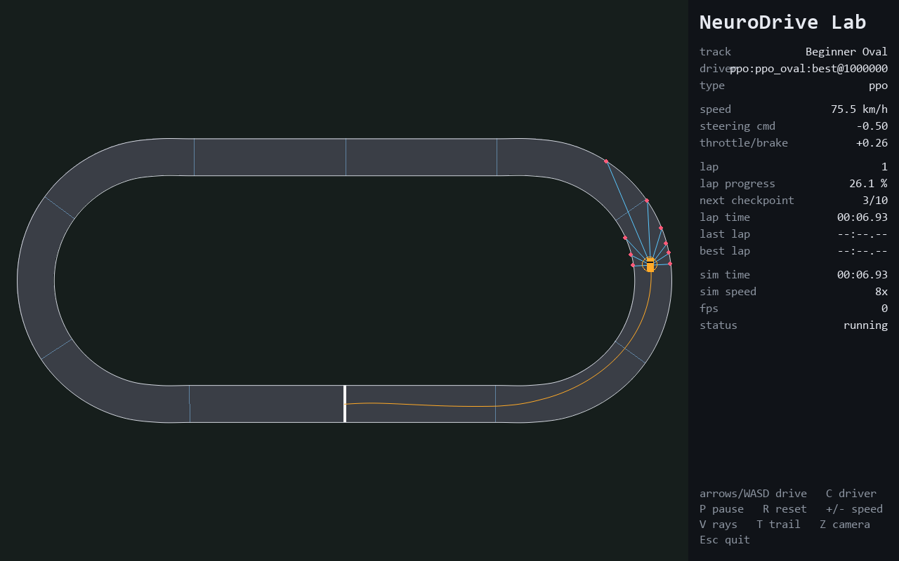

# Phase 3 report: PPO, the first trained driver

Date: 2026-11-24. Scope: spec §18 Phase 3; acceptance criteria from
[architecture-review.md §7](../architecture-review.md#7-refined-roadmap-with-acceptance-criteria).



## What we built

| Area | Files | Status |
|---|---|---|
| Experiment config (env + PPO hyperparameters + budget), validated | `training/config.py`, `configs/ppo/*.yaml` | implemented, tested |
| Training pipeline: seeding, parallel envs, run folders, metadata | `training/ppo.py` | implemented, tested |
| Checkpoints every 50k steps incl. step 0, best + final model | `training/ppo.py` | implemented, tested |
| Periodic validation evaluation + `eval_history.csv` | `training/ppo.py` | implemented, tested |
| TensorBoard: SB3 diagnostics + how episodes end + eval metrics | `training/ppo.py` | implemented |
| Resume from a checkpoint | `train ppo --resume` | implemented, tested |
| `PPOController`: loads a model, refuses mismatched observations | `agents/ppo_agent.py` | implemented, tested |
| CLI: `train ppo`, `evaluate --model`, `play --model` | `cli.py` | implemented, tested |
| PPO explanation + TensorBoard guide | `docs/ml-guide.md`, `docs/training-guide.md` | written |

## Results

Full tables in [results.md](../results.md). On 100 test scenarios:

| Driver | Laps | Lap time |
|---|---|---|
| PPO, untrained | 0/100 | — |
| PPO, 350k steps | 100/100 | 23.36 s |
| **PPO, 1M steps** | **100/100** | **21.61 s** |
| Heuristic (same inputs, hand-written) | 100/100 | 26.36 s |
| Autopilot (privileged) | 100/100 | 25.37 s |

PPO went from stalling to clean laps in 350,000 steps (about 9 minutes of training here),
then spent the remaining 650,000 steps getting 1.75 s faster. One seed, one easy track.

## How it works

See [ml-guide.md](../ml-guide.md#ppo-how-the-first-agent-learns-phase-3). In one
paragraph: the policy network outputs a bell curve over actions; the car samples from it
(exploration). After 16,384 steps across 8 parallel cars, each action is scored by how much
better things went than the critic network expected (the *advantage*). The policy is nudged
toward better-than-expected actions, but never more than a 20% change in probability per
update (the *clip*). Then the data is thrown away and the loop repeats.

## ML concepts this phase introduced

- **Policy as a probability distribution**, and why evaluation uses the mean action.
- **Actor and critic**: one network acts, one predicts future reward.
- **Advantage**: "better or worse than expected", the signal PPO learns from.
- **Clipping**: why PPO is stable.
- **On-policy learning**: experience is used once, then discarded.
- **Discounting (γ)**: why PPO got *faster* even though a lap's total reward is the same at
  any speed. Reward collected sooner is worth more to it.
- **Learning curves aren't monotonic**: progress dropped from 75% to 58% before the first laps.
- **Model selection on validation, reporting on test**.

## What we tested

```powershell
uv run pytest -q     # 141 passed
uv run ruff check .  # All checks passed!
uv run mypy          # Success: no issues found in 36 source files
```

New tests (`tests/smoke/test_ppo_training.py`): a 1,024-step run produces every expected
file (including the step-0 checkpoint and TensorBoard events); model metadata records the
observation spec and env config; a saved policy loads and gives valid, deterministic
actions; a model is refused in an environment with different observations, and without
its metadata file; resuming continues the same run; checkpoint ranking; a trained model
drives in the playground; shipped configs are valid; bad configs give one-line errors.

Acceptance criteria:

| Criterion | Result |
|---|---|
| Smoke run completes; checkpoint loads and drives | Yes (tests + manual run of `configs/ppo/smoke.yaml`) |
| Full run compared against baselines on shared scenarios | Yes, 100 test scenarios, table above |
| Improvement shown with numbers, or diagnosed | 0/100 → 100/100 laps; 21.61 s vs heuristic 26.36 s |
| One measured CPU vs CUDA comparison | **Not done.** Needs the CUDA build of PyTorch (~2.5 GB download); deferred, see below |

## Problems and limitations

- **My checkpoint-selection rule was wrong, and the training output exposed it.** I ranked
  checkpoints by validation return. But a completed lap is always worth the same return
  (0.1 × 491 m + 10), whether it takes 30 s or 20 s, so every lapping checkpoint scored
  ~59.15 and the "best" was decided by rounding noise. Fixed: checkpoints are now ranked by
  laps completed, then progress, then lap time. This run's `best_model` was chosen by the
  old rule (step 1M, 21.62 s on validation; the final model's 21.60 s would now win).
- **The same flaw affects the Phase 4 plan.** The review proposed NEAT fitness = the
  undiscounted episode return, "the same thing PPO optimizes". That's not quite true: PPO
  optimizes the *discounted* return, which rewards speed; the undiscounted return doesn't.
  With that fitness, NEAT would have no reason to drive faster once it can finish a lap.
  Phase 4 needs a fitness that values speed: the discounted return with the same γ, or
  progress plus a lap-time term. To decide at the start of Phase 4.
- **My first throughput measurement was flawed.** A PyTorch thread setting leaked between
  runs in the same process. Re-measured in separate processes. Finding: with default
  settings, two-thirds of training time is network updates, so more processes barely help.
- **Training speed** was 637 steps/s overall (including evaluations), below the ~900
  measured without evaluations.
- **One seed only.** Whether PPO learns this reliably is unknown until Phase 6 repeats it.
- **The task is easy.** The oval and its nearly identical test scenarios don't stress
  generalization. That's Phase 5.
- **No GPU measurement.** The CUDA build of PyTorch would need a ~2.5 GB download into a
  separate environment. Based on the profile (tiny network, batch 64), a GPU is unlikely
  to help, but that's a prediction, not a measurement.

## What comes next: Phase 4, NEAT

Evolve drivers with neat-python on the same environment: population, fitness (decide the
speed term first), generation statistics, champion saving, network topology drawing, and
evaluation on the same 100 test scenarios.
