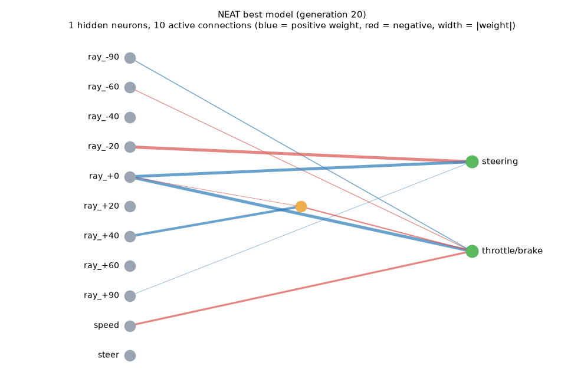

# Phase 4 report: NEAT, the evolved driver

Date: 2026-11-25. Scope: spec §18 Phase 4; acceptance criteria from
[architecture-review.md §7](../architecture-review.md#7-refined-roadmap-with-acceptance-criteria).



## What we built

| Area | Files | Status |
|---|---|---|
| NEAT experiment config + neat-python genome rules | `training/config.py`, `configs/neat/*.yaml`, `configs/neat/default.ini` | implemented, tested |
| Evolution loop: shared scenarios per generation, fitness with speed term, parallel scoring | `training/neat_trainer.py` | implemented, tested |
| Per-generation statistics, env-step counting, champions every generation | `training/neat_trainer.py` | implemented, tested |
| Validation every 5 generations, `best_model` by laps → progress → lap time | `training/neat_trainer.py`, `evaluation/metrics.py` | implemented, tested |
| Population checkpoints + `--resume` | neat-python `Checkpointer` | implemented, tested |
| `NEATController` + shared model loader for PPO and NEAT | `agents/neat_agent.py`, `agents/model_io.py` | implemented, tested |
| Network drawing, fitness and complexity plots; `show-network` CLI | `viz/network.py`, `cli.py` | implemented, tested |
| `train neat`, and `evaluate`/`play --model` accept NEAT models | `cli.py` | implemented, tested |

## Results

Full tables in [results.md](../results.md). One seed, the easy oval, 100 test scenarios:

| Driver | Env steps | Laps | Lap time |
|---|---|---|---|
| NEAT gen 0 (random networks) | 34,894 | 0/100 | — |
| NEAT gen 1 | 71,328 | 100/100 | 21.32 s |
| **NEAT best (gen 20)** | 1.95M | 100/100 | **19.74 s** |
| PPO best (Phase 3) | 1.00M | 100/100 | 21.61 s |
| Heuristic | — | 100/100 | 26.36 s |

## How it works

See [ml-guide.md](../ml-guide.md#neat-how-the-second-agent-evolves-phase-4). In short:
150 networks drive; the fittest breed (crossover + mutation of weights *and* structure);
species protect new structures; repeat. Every network starts as 11 inputs wired directly to
2 outputs.

## ML concepts this phase introduced

- **Gradient-free optimization**: improvement by selection, not by calculating gradients.
- **Evolving topology**: networks gain or lose neurons and connections.
- **Speciation** and why new structures need protection.
- **Fitness vs reward**: one score per episode vs feedback every step, and why fitness needs an
  explicit speed term where PPO gets one from discounting.
- **Common random numbers**: every genome in a generation faces the same starts.
- **Sample efficiency vs wall-clock**: NEAT used 12x the environment steps but less time.

## What we tested

```powershell
uv run pytest -q     # 151 passed
uv run ruff check .  # All checks passed!
uv run mypy          # Success: no issues found in 41 source files
```

New tests (`tests/smoke/test_neat_training.py`): fitness gives a speed bonus only for laps;
generation seeds are shared and never touch the validation/test ranges; a tiny run writes
every expected file; environment steps are counted; **the same seed gives an identical
evolution history**; the champion loads through the shared loader and acts
deterministically; a model is refused in a mismatched environment; the `.ini` must match
the observation size; resume continues the same run; `show-network` writes a PNG.

Also checked by hand: a 4-worker parallel run produced exactly the same generation history
as the serial run.

Acceptance criteria:

| Criterion | Result |
|---|---|
| Multiple generations execute | 100 generations |
| Fitness computed correctly | Unit test for the formula; laps, steps and crashes logged per generation |
| Candidate networks control actual vehicles | Every genome drives the real environment |
| Champions save and load | Every generation's champion saved; `best_model` evaluated through the CLI |
| Champion can be replayed | `play --model .../best_model.pkl` |
| Reproducible within documented limits | Same seed → identical history (test); parallel = serial (checked) |

## Problems and limitations

- **The oval is too easy to compare the two methods.** NEAT's generation-1 champion, a
  barely mutated random network, already laps every test scenario faster than PPO's final
  policy. When a minimal network solves a task by luck in 71k steps, the task can't tell
  learning methods apart. Phase 5 (harder and unseen tracks) matters more than planned.
- **NEAT stalled at generation 20.** The last 80 generations (about 10 million steps) didn't
  improve the best lap at all. For Phase 6, a step budget (`max_env_steps`) or an early-stop
  rule would save most of that time.
- **Speciation barely worked.** There was only one species until generation 48. I measured
  the genetic distances between networks: at generation 10, no pair was further apart than
  the species threshold (median distance 1.65 vs threshold 3.0); by generation 100, 46% of
  pairs were. So the threshold is too loose for networks this small. Lowering it (to about
  2.0) should give several species from the start. That changes how evolution behaves, so
  it should be tested and fixed *before* the Phase 6 comparison, not changed silently.
- **The fitness design differs from the architecture review.** The review said NEAT fitness =
  undiscounted episode return. Phase 3 showed that can't reward speed, so fitness = episode
  return + 1 point per second under the time limit (laps only).
- **The network drawing shows structure, not meaning.** It shows NEAT uses only some
  inputs (it ignores wheel angle and 3 of the 9 rays). That's a fact about this network;
  "it learned that those sensors don't matter" would be over-interpretation from one seed.
- **One seed per algorithm**, nearly identical test scenarios: same limits as Phase 3.
- Saved NEAT models are Python pickles: only load ones you trained yourself.

## What comes next: Phase 5, more tracks

Medium and hard tracks, both driving directions, validation and held-out test tracks,
random starting points along the track, and multi-track training. Then measure whether
PPO and NEAT learned to *drive*, or only learned the oval.
