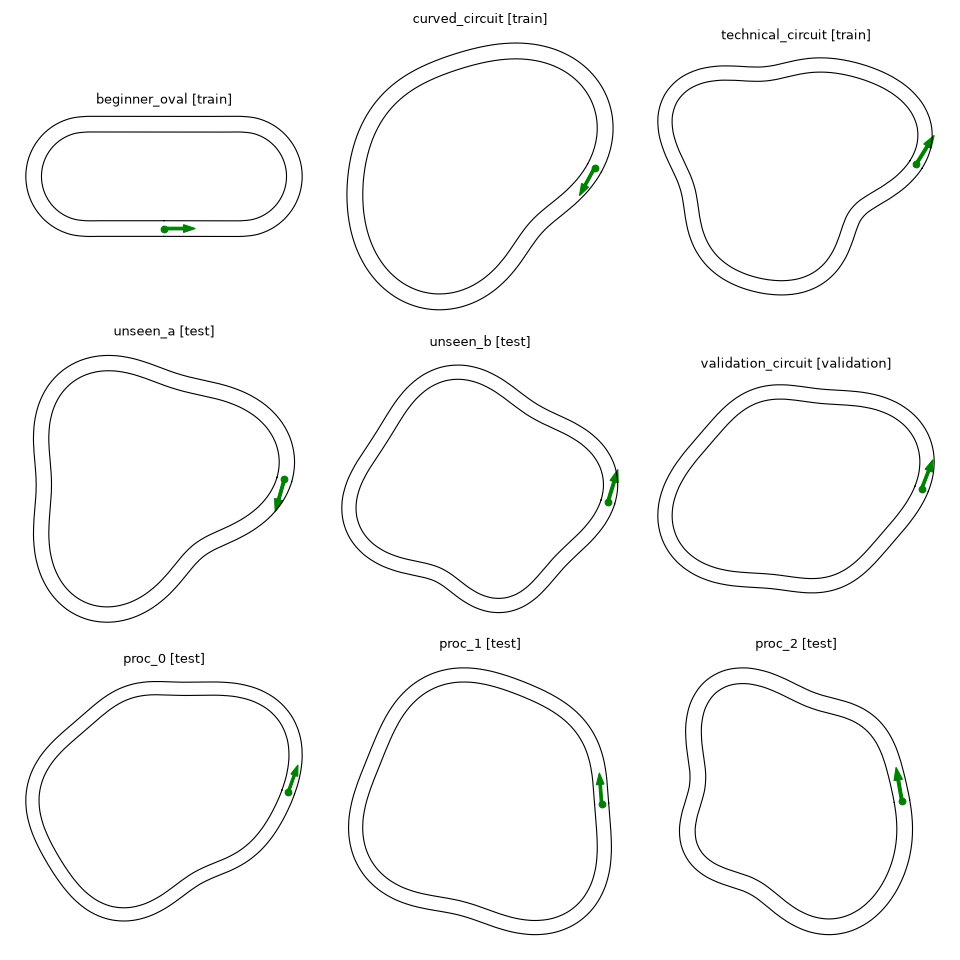

# Phase 5 report: more tracks and generalization

Date: 2026-11-25. Scope: spec §18 Phase 5; acceptance criteria from
[architecture-review.md §7](../architecture-review.md#7-refined-roadmap-with-acceptance-criteria).



## What we built

| Area | Files | Status |
|---|---|---|
| 5 new built-in tracks from shape formulas (train, validation, test; both directions) | `scripts/generate_tracks.py`, `src/neurodrive/tracks/*.yaml` | implemented, every track lapped by the autopilot in tests |
| Procedural test tracks `proc_<seed>`, guaranteed non-self-intersecting and validated | `sim/procedural.py` | implemented, tested |
| Random start points; laps counted from wherever the car starts | `sim/simulation.py`, `sim/progress.py` | implemented, tested |
| Multi-track environment (track picked per episode by the seed) | `env/driving_env.py`, `env/config.py` | implemented, tested |
| Split rules in code: train only on `train`, select on `validation`, never use `test` | `experiments/splits.py`; called by both trainers | implemented, tested |
| Validation tracks for checkpoint/champion selection | `training/config.py`, both trainers | implemented |
| NEAT scores every genome on every training track per generation | `training/neat_trainer.py` | implemented |
| `evaluate --tracks "split:test,proc:20" --start random` with per-track table | `cli.py` | implemented, tested |
| Multi-track configs; NEAT species threshold fixed (3.0 → 2.0) | `configs/ppo/multitrack.yaml`, `configs/neat/multitrack.*` | used for the runs below |

Track set:

| Track | Split | Direction | Width | Tightest turn |
|---|---|---|---|---|
| `beginner_oval` | train | counter-clockwise | 12 m | 32.2 m |
| `curved_circuit` | train | clockwise | 12 m | 52.1 m |
| `technical_circuit` | train | counter-clockwise | 10 m | 22.1 m |
| `validation_circuit` | validation | counter-clockwise | 11 m | 40.3 m |
| `unseen_a` | test | clockwise | 11 m | 39.1 m |
| `unseen_b` | test | counter-clockwise | 10 m | 29.7 m |
| `proc_<seed>` (any seed) | test | random | 11 m | varies |

## Results

Full tables in [results.md](../results.md). 26 tracks x 20 random-start test scenarios:

| Driver | Trained on | Laps |
|---|---|---|
| PPO | oval only | 63.7% (4% on clockwise tracks) |
| NEAT | oval only | 37.5% (0% on clockwise tracks) |
| **PPO** | **3 training tracks** | **100%**, 22.50 s mean |
| **NEAT** | **3 training tracks** | **100%**, 21.63 s mean |
| Heuristic | — | 100%, slower than both multi-track agents on all 26 tracks |
| Autopilot (privileged) | — | 100%, slower than both multi-track agents on all 26 tracks |

## ML concepts this phase introduced

- **Overfitting** you can see: both oval agents learned "turn left", not "drive". On the 9
  clockwise tracks PPO completed 4% of laps and NEAT 0%.
- **Train / validation / test split**: the test tracks never influenced training or
  model selection, so their scores honestly measure generalization. Enforced in code.
- **Training distribution matters**: adding one clockwise track and random starts was
  enough to generalize to 22 unseen tracks.
- **Generalization vs specialization**: the oval-only NEAT network was the fastest on the
  oval and the most brittle elsewhere.
- **Validation-based early stopping**: PPO's best checkpoint came at 600k of 2M steps.

## What we tested

```powershell
uv run pytest -q     # 174 passed
uv run ruff check .  # All checks passed!
uv run mypy          # Success: no issues found in 43 source files
```

New tests (`tests/integration/test_tracks_phase5.py`): every built-in track is lapped by
the autopilot; splits are as designed; both directions are present; 5 procedural tracks are
valid, drivable and test-only; procedural tracks are deterministic per seed and differ
between seeds; a random-start lap is one full circuit from the start point; random starts
are seeded and varied; the multi-track env picks tracks by seed and honours an explicit
track; evaluation covers every (track, seed) pair; training on validation/test/procedural
tracks is refused; selecting on test tracks is refused; the `--tracks` shortcuts expand
correctly.

Acceptance criteria:

| Criterion | Result |
|---|---|
| Track layouts change without simulation rewrites | 5 new tracks + unlimited procedural ones, no simulation changes needed |
| Evaluation tracks excluded from training | Enforced in code (`SplitError`), tested |
| Generalization measured | 26-track tables for oval-only and multi-track agents |
| Overfitting identified, not hidden | Oval-only agents: 63.7% / 37.5%, 4% / 0% on clockwise tracks |

## Problems and limitations

- **One seed per algorithm and setting.** Phase 6 repeats everything over several seeds.
- **Budgets aren't matched.** NEAT's chosen model used 13x the environment steps of PPO's.
- **The two multi-track runs shared the CPU**, so their wall-clock times aren't comparable.
- **The procedural tracks are all one family** (smooth radial shapes, 11 m wide). No
  hairpins, chicanes or very narrow sections. "Generalizes to 22 unseen tracks" means
  tracks of this kind.
- **The heuristic also laps every track.** These tracks are within reach of simple
  reactive driving, so they test generalization more than difficulty. Harder track
  families would be a useful extension.
- **My first guess at the failure cause was checked, not assumed.** I suspected
  "clockwise tracks"; splitting the results by direction confirmed it (95% vs 4% for PPO).

## Per-track results of the oval-only agents

(20 random-start test scenarios per track: laps completed, PPO / NEAT.)

| Track | PPO | NEAT | | Track | PPO | NEAT |
|---|---|---|---|---|---|---|
| beginner_oval | 20 | 20 | | proc_7 (CW) | 0 | 0 |
| curved_circuit (CW) | 8 | 0 | | proc_8 | 20 | 20 |
| technical_circuit | 19 | 0 | | proc_9 (CW) | 0 | 0 |
| validation_circuit | 20 | 20 | | proc_10 (CW) | 0 | 0 |
| unseen_a (CW) | 0 | 0 | | proc_11 | 20 | 1 |
| unseen_b | 20 | 0 | | proc_12 | 20 | 0 |
| proc_0 | 20 | 20 | | proc_13 | 20 | 20 |
| proc_1 | 20 | 20 | | proc_14 (CW) | 0 | 0 |
| proc_2 | 20 | 0 | | proc_15 (CW) | 0 | 0 |
| proc_3 (CW) | 0 | 0 | | proc_16 | 20 | 7 |
| proc_4 | 20 | 16 | | proc_17 | 20 | 14 |
| proc_5 | 20 | 20 | | proc_18 | 4 | 0 |
| proc_6 | 20 | 17 | | proc_19 (CW) | 0 | 0 |

## What comes next: Phase 6, the fair comparison

PPO vs NEAT with **matched environment-step budgets**, **several seeds each**, on the
multi-track setup, plus baselines: learning curves against steps and wall-clock,
confidence intervals, stability across seeds, generalization to test tracks, and failure
analysis. Every claim backed by a table that one command regenerates.
