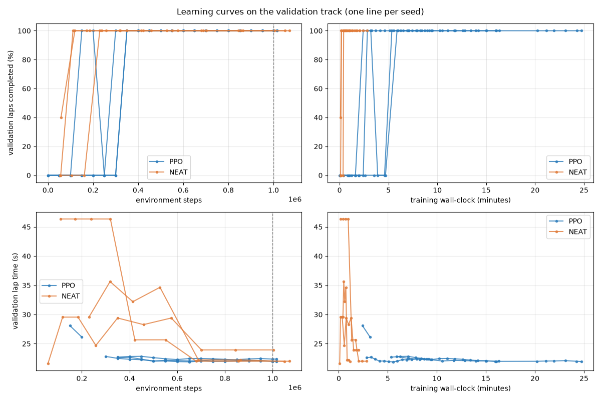

# Phase 6 report: fair PPO vs NEAT benchmark

Date: 2026-11-25. Scope: spec §18 Phase 6; acceptance criteria from
[architecture-review.md §7](../architecture-review.md#7-refined-roadmap-with-acceptance-criteria).

## What we built

| Area | Files | Status |
|---|---|---|
| Benchmark config: budget, seeds, algorithms, test scenarios | `benchmark/config.py`, `configs/benchmark/*.yaml` | implemented, tested |
| Resumable runner: trains every (algorithm, seed) under the same env-step budget, one run at a time, then evaluates models and baselines on identical test scenarios | `benchmark/runner.py` | implemented, smoke-tested, used for the run below |
| NEAT step budget: stops at the generation boundary nearest the budget | `training/neat_trainer.py` | implemented, tested |
| Report: per-run table, mean ± std and range across seeds, pooled Wilson intervals, per-track comparison, learning curves | `benchmark/report.py` | implemented, tested |
| CLI: `neurodrive benchmark run` / `benchmark report` | `cli.py` | implemented |

## How it was run

```
uv run python -m neurodrive benchmark run --config configs/benchmark/default.yaml
```

- Budget: 1,000,000 environment steps per run (PPO stops at the end of a rollout, NEAT at
  the nearest generation boundary; actual steps are reported).
- Seeds 0, 1, 2 for each algorithm; configs `configs/ppo/multitrack.yaml` and
  `configs/neat/multitrack.yaml` (three training tracks, random starts).
- Test: 26 tracks (6 built-in + 20 procedural), 20 test scenarios each, random starts,
  scenario seeds from the test range, identical for every driver.

Committed output: [`results/benchmark/ppo_vs_neat_1m/`](../../results/benchmark/ppo_vs_neat_1m/report.md).
Full run folders and models stay in `runs/benchmark/` (git-ignored).

## Results (3 seeds each, 520 test episodes per run)

| | PPO | NEAT |
|---|---|---|
| Test laps completed | 92.6% ± 9.9 (81.3 to 100.0) | **98.5% ± 1.8** (96.5 to 100.0) |
| Pooled test laps (95% CI) | 1445/1560 (91.2 to 93.8%) | 1536/1560 (97.7 to 99.0%) |
| Test lap time | **22.30 s ± 0.28** (21.98 to 22.48) | 23.54 s ± 0.83 (22.73 to 24.39) |
| Steps to first validation lap | 266,667 ± 104,083 | 132,871 ± 88,031 |
| Training wall-clock | 16.6 min ± 7.8 | 2.0 min ± 0.9 |

Baselines on the same scenarios: heuristic 520/520 at 29.56 s, autopilot 520/520 at
28.02 s, smoothed random 0/520. Every trained run beat both scripted drivers on lap time.



## What it means

- **At an equal budget, PPO drives faster, NEAT is more reliable.** PPO was faster on all
  26 tracks (averaged over seeds) and in all 9 seed pairings. NEAT completed more laps:
  the pooled confidence intervals do not overlap.
- **The Phase 5 result flipped.** In Phase 5 NEAT looked faster (21.63 s vs 22.50 s), but
  it had used ~11.5M steps against PPO's 2M. Given the same 1M steps (only ~10
  generations), NEAT is slower. This is why matched budgets matter.
- **Failures are per-track, not random.** PPO seed 2 failed every scenario on four
  procedural tracks (`proc_3`, `proc_7`, `proc_9`, `proc_15`) and 17/20 on `proc_18`;
  PPO seed 0 failed 18/20 on `proc_11`; NEAT seed 1 failed 15/20 on `proc_3`. A
  deterministic policy either handles a corner shape or it does not. PPO seed 2's lap
  time is computed only over the tracks it finished, so it is flattered a little.
- **NEAT learns to lap sooner in steps and far sooner in wall-clock** (parallel
  evaluation over 12 workers; PPO spends most of its time on network updates).
- **Seed variance is large.** One PPO seed reached 100%, another 81%. Three seeds is
  enough to see that spread, not enough to pin down the means.

## Caveats

- Wall-clock times grew from run to run for both algorithms (PPO 9 → 16 → 25 min, NEAT
  1.1 → 2.1 → 2.9 min). Other programs were using the CPU during the benchmark, so treat
  the wall-clock numbers as rough; the step counts are exact.
- One budget (1M steps). With more steps NEAT kept improving in Phase 5; a longer
  benchmark could change the lap-time ranking.
- Hyperparameters were not tuned per algorithm for this budget.

## Acceptance

- Same budget, same seeds, same test scenarios for both algorithms: met.
- Results reported with spread across seeds and confidence intervals: met.
- Resumable and reproducible from one command: met (smoke test re-runs and resumes).
- No invented numbers: every number above comes from the committed report files.
