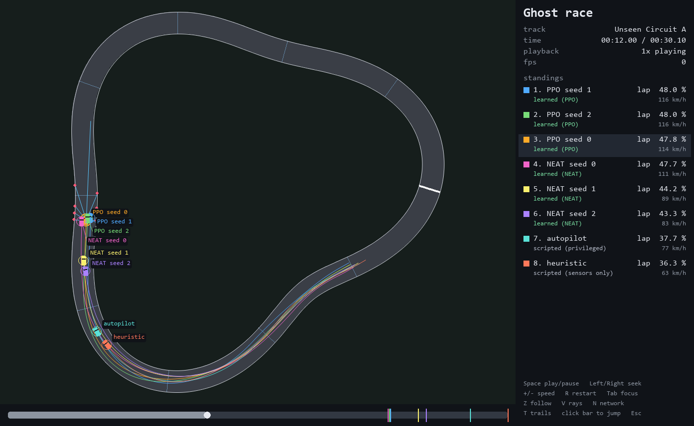
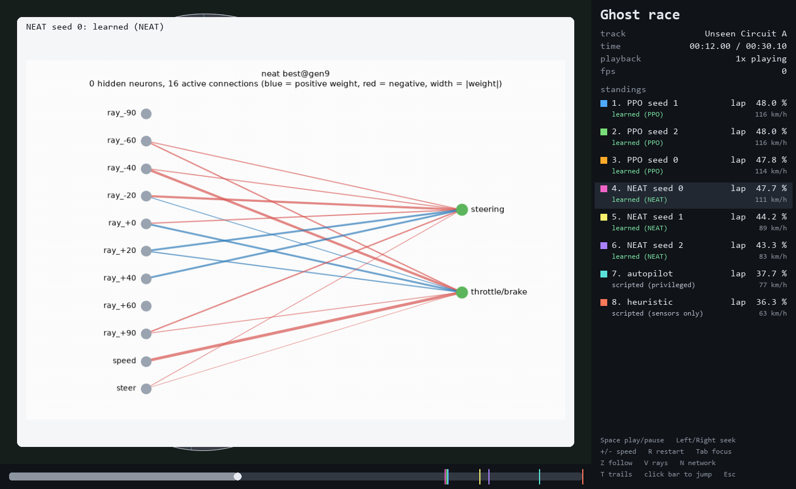
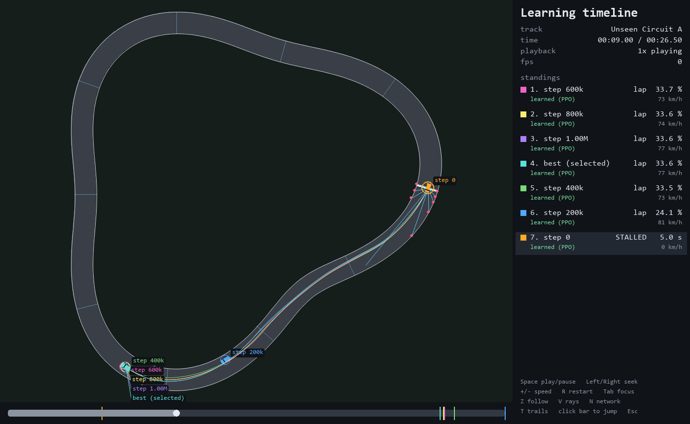

# Phase 7 report: interactive lab

Date: 2026-11-25. Scope: spec §18 Phase 7, cut down as agreed in
[architecture-review.md §7](../architecture-review.md#7-refined-roadmap-with-acceptance-criteria):
four screens (playground, replay viewer, side-by-side comparison, learning timeline), a
network panel, and learning curves as images rather than live charts.

## What we built

| Area | Files | Status |
|---|---|---|
| Replay file (`.npz`): per-step pose, speed, steering, lap progress, sensor rays, actions; JSON metadata with driver, scenario, full env config, ending | `replay/format.py` | implemented, tested |
| Recorder: runs any driver through the same `DrivingEnv` the evaluator uses | `replay/recorder.py` | implemented, tested |
| Replay verification: re-simulates the stored actions and requires every stored state to match exactly | `replay/recorder.py` (`verify_replay`), `replay --verify` | implemented, tested (a tampered action is caught) |
| Replay viewer: ghost cars, standings, learned/scripted labels, seek bar, 0.25x to 8x, follow camera, sensor rays, trails | `ui/replay_viewer.py` | implemented, smoke-tested headless, run in a real window |
| Network panel: NEAT's evolved graph; PPO's fixed layer sizes and weight count | `ui/replay_viewer.py`, `replay/recorder.py` | implemented, tested |
| Commands: `demo`, `race`, `timeline`, `record`, `replay` | `cli.py`, `replay/lab.py` | implemented, tested |
| Playground shows "learned (PPO)" / "scripted (privileged)" etc. instead of raw kinds | `ui/app.py` | implemented |

The four screens and how to open them:

| Screen | Command |
|---|---|
| Playground | `neurodrive play` (unchanged since Phase 2, plus clearer driver types) |
| Replay viewer | `neurodrive replay FILE...` |
| Side-by-side comparison | `neurodrive race ...` or `neurodrive demo` |
| Learning timeline | `neurodrive timeline RUN_DIR` |

Learning curves stay as the matplotlib images from Phases 3 to 6 and TensorBoard.

## Design choices

- **Record first, then play.** A race records every driver headless (a few seconds), then
  the viewer only draws stored arrays. No model runs during playback, so eight cars cost
  the same as one and seeking backwards is free.
- **Replays are checkable.** The simulator is deterministic, so a replay that cannot be
  re-simulated step for step is a bug, not noise. `replay --verify` checks this.
- **Same scenario for every car.** All drivers in a race share the track, the scenario
  seed and the start (the start line by default), so the race is a fair visual comparison.
- **Honest labels.** Every car carries its name on track; the panel says whether each
  driver is learned (PPO, NEAT), scripted from sensors only, or scripted with privileged
  information.

## Measured

- Real window, 8-car race on `unseen_a`, 900 frames: **60.2 FPS** average (the 60 FPS
  cap), drawing **3.5 ms** per frame on average, 5.8 ms at the 95th percentile.
  Command: `uv run python -m neurodrive replay <8 replay files> --frames 900`.
- Recording 8 drivers takes about 15 s, mostly loading the PPO models and drawing the
  NEAT networks.
- 197 tests pass (18 new).

## What the new views show

- On `unseen_a` from the start line, every benchmark model and both scripted drivers
  finish the lap: NEAT seed 0 22.88 s, PPO seeds 22.95 to 23.03 s, NEAT seeds 1 and 2
  24.68 and 25.20 s, autopilot 27.83 s, heuristic 30.10 s. One scenario only: the
  benchmark report is the real comparison.
- **The PPO timeline** (seed 1): the untrained policy at step 0 stalls; at 200k steps it
  laps in 26.50 s; by 1M steps 23.03 s. Steady improvement.
- **The NEAT timeline** (seed 1) is bumpier: generation 2 laps in 29.35 s, generation 4
  in 33.32 s, generation 7 in 24.68 s. Each generation's champion is the best on the
  *training* tracks, which does not guarantee it is better on this unseen track.
- **The NEAT seed 0 champion has no hidden neurons**: 16 direct connections from the
  sensors to steering and throttle. NEAT started minimal and found that enough to lap
  every test track. PPO's policy has 5,058 weights.

## Not done (by design, per the review)

- No live view attached to a training run; no charts drawn inside pygame; no menu system
  beyond the separate commands.

## Acceptance

- A new user can launch each screen from the README commands: met (`demo` needs no
  arguments and falls back to the scripted drivers if nothing is trained).
- Every car on screen is labeled with its controller type: met.
- Demos run at a steady frame rate with measured FPS: met (60.2 FPS, 8 cars).
- The UI does not affect headless training: the viewer and recorder are separate modules
  that training never imports.
