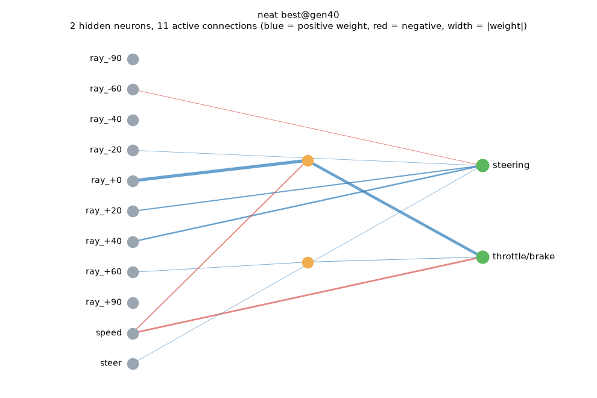
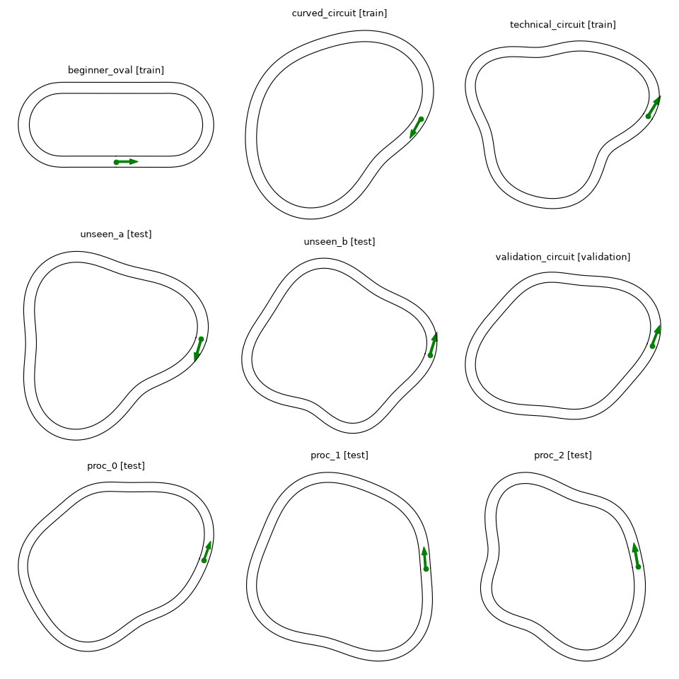
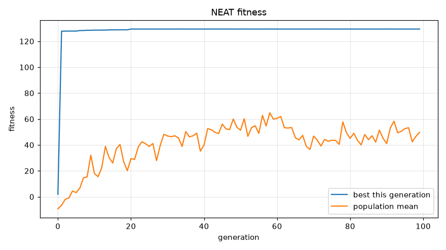
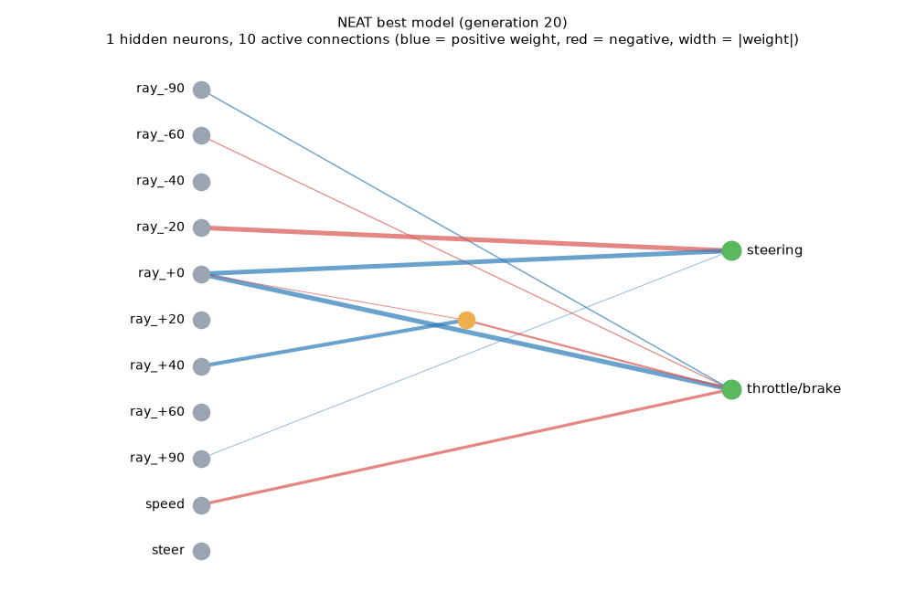

# Measured results

Only numbers that were actually measured go here, each with the exact command, the
machine, and the date.

## Checkpoint re-selection and three-seed racing (Phase 10)

**Setup:** 2026-11-25 to 2026-11-26, i9-13900HX laptop, CPU only; two training jobs shared
the CPU. Full write-up: [phases/phase-10.md](phases/phase-10.md).

**Re-selection on 7 validation tracks** (`benchmark reselect --dir ...`; no retraining):
PPO 92.6% to 97.6% of laps at 1M, 87.8% to 96.9% at 5M; NEAT 98.5% to 98.8% and 100% to
100%. [1M](../results/benchmark/ppo_vs_neat_1m/reselection.md),
[5M](../results/benchmark/ppo_vs_neat_5m/reselection.md).

**Traffic, 3 seeds** (22 test tracks x 20 scenarios per model; `evaluate --model M --tracks split:test,proc:20 --start random --split test --episodes 20 --traffic 0|3`):

| Driver | Alone | With 3 opponents | Hits per episode in traffic |
|---|---|---|---|
| PPO trained alone | 93.1%, 22.47 s | 85.2%, 25.50 s | 2.98 |
| PPO trained with traffic | 96.5%, 22.05 s | 93.0%, 23.82 s | 1.61 |
| NEAT trained alone | 98.6%, 21.67 s | 51.2%, 31.01 s | 0.48 |
| NEAT trained with traffic | 97.3%, 24.59 s | 96.9%, 25.83 s | 0.88 |

[summary.csv](../results/traffic/phase10/summary.csv),
[per_seed.csv](../results/traffic/phase10/per_seed.csv).

**Grand Prix, one per seed** (12 races each, 2 laps, grid rotated, F1 points), totals:
NEAT trained with traffic 575, PPO trained with traffic 527, PPO trained alone 512,
heuristic 431, autopilot 418, NEAT trained alone 341.
[Standings](../results/grand_prix/phase10/summary.md).

## Longer training, hard physics and racing (Phase 9)

**Setup:** 2026-11-25 to 2026-11-26, i9-13900HX laptop, CPU only. Up to four jobs shared
the CPU and the runs were interrupted once (laptop shutdown) and paused twice, so
wall-clock times are rough; step counts are exact. Full write-up:
[phases/phase-9.md](phases/phase-9.md).

**5M-step benchmark** (`benchmark run --config configs/benchmark/long.yaml`; 3 seeds; 26
tracks x 20 test scenarios): PPO 1370/1560 laps (87.8% ± 12.4 across seeds; 95% CI
86.1-89.4%), 22.36 s ± 0.17; NEAT **1560/1560** (100%; CI 99.8-100.0%), **21.59 s ± 0.13**.
NEAT faster on 25 of 26 tracks and in 9 of 9 seed pairings. At 1M steps the lap-time
ranking was the other way round (PPO 22.30 s, NEAT 23.54 s).
[Report](../results/benchmark/ppo_vs_neat_5m/report.md).

**Hard-physics benchmark** (`configs/benchmark/dynamic.yaml`; tyre slip; 3M steps; 3
seeds): PPO 77.2% laps, 27.75 s, 22.8% crashes; NEAT 88.1% laps, 33.95 s, 1.9% crashes;
autopilot 100%, 38.03 s; heuristic 30.0%, 32.04 s.
[Report](../results/benchmark/ppo_vs_neat_dynamic_3m/report.md).

**Traffic** (seed 0 each; 22 test tracks x 20 scenarios; `evaluate --traffic 0|3`):

| Driver | Alone | With 3 opponents | Hits per episode in traffic |
|---|---|---|---|
| PPO trained alone | 100%, 22.59 s | 99.5%, 25.77 s | 2.59 |
| PPO trained with traffic | 98.0%, 21.91 s | 93.6%, 23.21 s | 1.48 |
| NEAT trained alone | 100%, 21.74 s | 42.5%, 33.15 s | 0.24 |
| NEAT trained with traffic | 100%, 23.02 s | 52.7%, 24.10 s | 0.08 |

**Grand Prix** (12 races, 2 laps, grid rotated, F1 points): NEAT trained with traffic
198, PPO trained alone 196, PPO trained with traffic 174, heuristic 140, autopilot 132,
NEAT trained alone 104. [Standings](../results/grand_prix/phase9/standings.md).

## Replay viewer frame rate (Phase 7)

**Setup:** 2026-11-25, i9-13900HX laptop, real window 1400x860.
`uv run python -m neurodrive replay <8 replay files> --frames 900`, eight cars on
`unseen_a`: **60.2 FPS** average (the 60 FPS cap), drawing 3.5 ms per frame on average and
5.8 ms at the 95th percentile. Details in [phases/phase-7.md](phases/phase-7.md).

## Fair benchmark: PPO vs NEAT at 1M environment steps (Phase 6)

**Setup:** 2026-11-25, i9-13900HX laptop, CPU only.
`uv run python -m neurodrive benchmark run --config configs/benchmark/default.yaml`.
Each algorithm trained with seeds 0, 1, 2 on the three training tracks for 1,000,000
environment steps (PPO used 1,015,808; NEAT 1,003,470 to 1,071,614, stopping at a
generation boundary). Every model and baseline was then tested on the same 26 tracks x 20
test scenarios with random starts. Full report:
[results/benchmark/ppo_vs_neat_1m/report.md](../results/benchmark/ppo_vs_neat_1m/report.md).

| Run | Test laps | Lap time | Collisions |
|---|---|---|---|
| PPO seed 0 | 502/520 | 22.48 s | 3.5% |
| PPO seed 1 | 520/520 | 22.45 s | 0.0% |
| PPO seed 2 | 423/520 | 21.98 s | 18.7% |
| NEAT seed 0 | 520/520 | 22.73 s | 0.0% |
| NEAT seed 1 | 502/520 | 24.39 s | 3.5% |
| NEAT seed 2 | 514/520 | 23.50 s | 1.2% |
| heuristic | 520/520 | 29.56 s | 0.0% |
| autopilot | 520/520 | 28.02 s | 0.0% |
| smoothed random | 0/520 | n/a | 57.9% |

Pooled test laps: PPO 1445/1560 (95% CI 91.2 to 93.8%), NEAT 1536/1560 (97.7 to 99.0%).
Mean lap time across seeds: PPO 22.30 s +/- 0.28, NEAT 23.54 s +/- 0.83; PPO faster on all
26 tracks and in all 9 seed pairings.

**Reading:** at equal budget PPO is faster but less reliable; NEAT laps more often. This
reverses the Phase 5 lap-time ranking, which came from NEAT using about 6x more steps.
Failures cluster on specific procedural tracks (PPO seed 2 failed all scenarios on four of
them). Lap times average completed laps only. Wall-clock times (PPO 9 to 25 min, NEAT 1.1
to 2.9 min) rose across the run while other programs shared the CPU: rough only. Details
in [phases/phase-6.md](phases/phase-6.md).

## Multi-track training fixes the overfitting (Phase 5)

**Setup:** 2026-11-25. Both algorithms retrained on the three **training** tracks
(`beginner_oval` counter-clockwise, `curved_circuit` clockwise, `technical_circuit`
counter-clockwise), from random start points; best version chosen on the separate
`validation_circuit`. Then evaluated exactly like the oval-trained drivers: 26 tracks x 20
random-start test scenarios. **The PPO and NEAT runs shared the CPU for the first ~11
minutes, so their wall-clock times are not clean measurements.**

```powershell
uv run python -m neurodrive train ppo --config configs/ppo/multitrack.yaml
uv run python -m neurodrive train neat --config configs/neat/multitrack.yaml
```

| | PPO multi-track | NEAT multi-track |
|---|---|---|
| Run folder (git-ignored) | `runs/ppo/ppo_multitrack_seed0_20261125-020842` | `runs/neat/neat_multitrack_seed0_20261125-020836` |
| Training budget | 2,015,232 env steps, 1,813 s | 60 generations, 11,456,428 env steps, 672 s |
| First full laps on validation track | 400k steps | generation 5 (402k steps) |
| Chosen model | step 600k (validation lap 21.93 s) | generation 40, 7.74M steps (validation lap 20.98 s) |
| Chosen network | 64x64 MLP | 2 hidden neurons, 11 connections |
| **All 26 tracks: laps** | **520/520 (95% CI 99.3-100%)** | **520/520 (95% CI 99.3-100%)** |
| Mean lap time over all 520 laps | 22.50 s | 21.63 s |
| Unseen `unseen_a` / `unseen_b` | 23.07 s / 22.46 s | 21.65 s / 21.67 s |

For reference, on the same 520 scenarios: `heuristic` 520/520, `autopilot` 520/520 (both
slower on every track; see the previous section's per-track tables in the Phase 5
report).

**What this shows:**

- **Training on varied tracks (both directions, random starts) fixed the overfitting.**
  Both agents now complete every lap on every track, including the 22 they never trained
  on. The oval-only versions managed 63.7% (PPO) and 37.5% (NEAT).
- **NEAT's chosen driver is faster than PPO's on 25 of 26 tracks**, by 0.86 s on average
  (range: 0.79 s slower to 1.76 s faster).
- **But NEAT's model used 13x more environment steps** (7.74M vs 0.6M). With one seed each
  and unequal budgets, this is *not* evidence that NEAT is better in general. Phase 6
  compares them at matched budgets, over several seeds.
- **PPO peaked early, then drifted:** its validation lap time was best at 600k steps
  (21.93 s) and slightly worse afterwards (22.46 s at 2M); the final model is 0.25 s
  slower on average across the 26 tracks (22.75 s vs 22.50 s). Validation-based selection
  caught that.
- **Speciation now works** with `compatibility_threshold = 2.0`: 2 to 10 species
  throughout, vs a single species until generation 48 in Phase 4.



The chosen NEAT network's weights (a description, not a claim about "intent"): the right-side
rays (+20 deg, +40 deg) push steering right and the -60 deg ray pushes it left; the straight-ahead
ray raises throttle through a hidden neuron; speed pushes toward braking. That's close in
form to the hand-written heuristic, tuned to drive ~30% faster.

## Generalization: oval-trained drivers on new tracks (Phase 5)

**Question:** PPO and NEAT were trained only on the Beginner Oval (Phases 3-4). Did they learn
to *drive*, or to drive *the oval*?

**Setup:** 2026-11-25. Each driver gets 20 episodes per track, starting from a **random
point around the track** (plus the usual small offset), on 26 tracks: the 6 built-in
tracks and 20 procedural tracks (`proc_0`..`proc_19`, all test-only). Test scenario seeds.
Same scenarios for every driver.

```powershell
uv run python -m neurodrive evaluate --model <model> --tracks "beginner_oval,curved_circuit,technical_circuit,validation_circuit,unseen_a,unseen_b,proc:20" --start random --episodes 20 --split test
```



| Driver | Trained on | Laps completed, all 26 tracks (95% CI) |
|---|---|---|
| PPO `best_model` (Phase 3) | oval only | 331/520 = 63.7% (59.4-67.7%) |
| NEAT `best_model` (Phase 4) | oval only | 195/520 = 37.5% (33.4-41.7%) |
| `heuristic` (hand-written, same sensors) | — | 520/520 = 100% (99.3-100%) |
| `autopilot` (scripted, privileged) | — | 520/520 = 100% (99.3-100%) |

**Split by the direction a track is driven:**

| Track direction | Tracks | PPO lap rate | NEAT lap rate |
|---|---|---|---|
| Counter-clockwise (same as the oval) | 17 | 95% | 57% |
| Clockwise (opposite) | 9 | 4% | 0% |

(Mean of per-track lap rates. The clockwise tracks are `curved_circuit`, `unseen_a`, and
`proc_3, 7, 9, 10, 14, 15, 19`.)

**What this shows:**

- **Both agents overfit to the oval.** The oval is driven counter-clockwise, so it only ever
  turns left. On tracks that turn right, PPO completes 4% of laps and NEAT none: they
  never learned right turns.
- **PPO generalized better to new shapes in the familiar direction** (95% vs NEAT's 57%).
  NEAT's evolved 10-connection network got the oval fast but is brittle elsewhere: on
  several counter-clockwise tracks it barely leaves the start (e.g. `proc_12`: 0/20).
- **The 10-line hand-written heuristic beats both learned agents on generality**, though
  it's slower wherever they do finish (e.g. oval 26.07 s vs PPO 21.48 s, NEAT 19.37 s).
  Learning bought speed on the training track at the cost of robustness.
- Per-track tables: `runs/eval/phase5_zeroshot/<driver>/summary.json` (git-ignored) and
  the console output recorded in the Phase 5 report.

## Second trained agent: NEAT on the Beginner Oval (Phase 4)

**One evolution seed (seed 0), one easy track.** Same caveats as PPO.

**Evolution:** `uv run python -m neurodrive train neat --config configs/neat/default.yaml`
on 2026-11-25. Population 150, 100 generations, each genome scored on 2 shared starting
scenarios per generation, fitness = episode reward + 1 per second a lap finishes under
90 s. 12 worker processes. **12,050,593 environment steps** (30,000 episodes) in 1,070 s
(17.8 min): 11,260 steps/s. Run folder (git-ignored):
`runs/neat/neat_oval_seed0_20261125-010551`.

**Evolution curve** (training data from `generations.csv`; "laps" = share of all
genome-episodes in that generation that finished):

| Generation | Env steps used | Best fitness | Best lap in generation | Species | Best network |
|---|---|---|---|---|---|
| 0 | 34,894 | 1.9 | — (no laps) | 1 | 0 hidden, 22 connections |
| 1 | 71,328 | 127.8 | 21.35 s | 1 | 0 hidden, 22 connections |
| 5 | 298,135 | 127.8 | 21.32 s | 1 | 0 hidden, 22 connections |
| 10 | 766,783 | 128.6 | 20.57 s | 1 | 1 hidden, 14 connections |
| 20 | 1,951,101 | 129.4 | 19.73 s | 1 | 1 hidden, 10 connections |
| 50 | 5,736,872 | 129.4 | 19.73 s | 2 | 1 hidden, 10 connections |
| 99 | 12,050,593 | 129.4 | 19.73 s | 4 | 1 hidden, 10 connections |



**Test scenarios** (the same 100 as every driver in Phase 3):

| Driver | Env steps of training | Laps (95% CI) | Lap time over completed laps |
|---|---|---|---|
| NEAT gen 0 champion | 34,894 | 0/100 (0-3.7%) | — (100 collisions, at 24% of the lap) |
| NEAT gen 1 champion | 71,328 | 100/100 (96.3-100%) | 21.32 s (best 21.17), n = 100 |
| NEAT gen 5 champion | 298,135 | 100/100 (96.3-100%) | 21.32 s (best 21.17), n = 100 |
| NEAT gen 12 champion (closest to PPO's 1M steps) | 972,707 | 100/100 (96.3-100%) | 20.57 s (best 20.55), n = 100 |
| **NEAT `best_model` (gen 20, chosen on validation)** | 1,951,101 | **100/100 (96.3-100%)** | **19.74 s (best 19.73), n = 100** |
| PPO `best_model` (Phase 3) | 1,000,000 | 100/100 (96.3-100%) | 21.61 s (best 21.55), n = 100 |
| `heuristic` | — | 100/100 (96.3-100%) | 26.36 s, n = 100 |

(The gen 1 and gen 5 champions are likely the same genome carried over by elitism: they
score identically.)

**What this shows, and what it doesn't:**

- **On this oval, NEAT found a lapping driver almost immediately.** One generation of
  mutation from random 22-connection networks (71k env steps) produced a driver that laps
  every test scenario, already faster than PPO's final policy. PPO needed ~350k steps for
  its first laps. **This mostly says the oval is easy**: a nearly linear mapping from rays
  to controls is enough to drive it. It is not yet evidence that NEAT is the better method.
- **NEAT got fast and then stopped improving.** The best lap reached 19.73 s at generation
  20 and never changed in the remaining 80 generations (~10 million steps).
- **The evolved network is small and ignores some inputs:** 1 hidden neuron, 10 active
  connections. It doesn't use the wheel-angle input or the -40°, +20° and +60° rays at all.
  (A drawing shows connections, not meaning; see below.)
- **At a comparable budget** (gen 12, 0.97M steps vs PPO's 1M), NEAT's champion laps in
  20.57 s vs PPO's 21.61 s. That's one seed each, on the easiest track, so it's a pointer
  for Phase 6, not a result.
- **Wall-clock:** NEAT used 12x more environment steps than PPO but finished in 17.8 min vs
  26.6 min, because it needs no gradient updates and scores genomes on 12 processes
  (11,260 vs 637 steps/s).
- **Speciation barely worked:** see the Phase 4 report. One species until
  generation 48.



## First trained agent: PPO on the Beginner Oval (Phase 3)

**One training seed (seed 0).** This shows PPO *can* learn this task; it says nothing
yet about how reliably it learns (that needs several seeds: Phase 6).

**Training:** `uv run python -m neurodrive train ppo --config configs/ppo/default.yaml`
on 2026-11-24. Stable-Baselines3 default hyperparameters, 8 `subproc` environments, CPU.
1,015,808 steps (training stops at the end of a rollout) in 1,596 s (26.6 min), i.e.
637 steps/s including periodic evaluations. Run folder (git-ignored):
`runs/ppo/ppo_oval_seed0_20261124-221617`.

**Learning curve** (deterministic policy, 10 validation scenarios, from `eval_history.csv`):

| Steps | Laps (of 10) | Mean lap progress | Lap time |
|---|---|---|---|
| 0 | 0 | 0.0% | — |
| 50,000 | 0 | 6.8% | — |
| 100,000 | 0 | 8.0% | — |
| 150,000 | 0 | 24.5% | — |
| 200,000 | 0 | 72.4% | — |
| 250,000 | 0 | 74.9% | — |
| 300,000 | 0 | 57.7% | — |
| 350,000 | 10 | 100% | 23.36 s |
| 500,000 | 10 | 100% | 22.42 s |
| 750,000 | 10 | 100% | 21.79 s |
| 1,000,000 | 10 | 100% | 21.62 s |

Not monotonic: progress fell from 74.9% to 57.7% between 250k and 300k steps before the
first full laps at 350k.

**Comparison on the 100 test scenarios** (seeds 2,000,000-2,000,099, shared by every
driver; nothing was selected or tuned on them):

```powershell
uv run python -m neurodrive evaluate --controller <name> --episodes 100 --split test
uv run python -m neurodrive evaluate --model <run>/<checkpoint>.zip --episodes 100 --split test
```

| Driver | Laps (95% CI) | Lap time over completed laps | Endings |
|---|---|---|---|
| `random` | 0/100 (0-3.7%) | — | 100 stalled |
| `smoothed_random` | 0/100 (0-3.7%) | — | 59 collision, 41 stalled |
| `heuristic` (hand-written, same inputs) | 100/100 (96.3-100%) | 26.36 s (best 26.35), n = 100 | all laps |
| `autopilot` (scripted, privileged) | 100/100 (96.3-100%) | 25.37 s (best 25.37), n = 100 | all laps |
| PPO, step 0 (untrained) | 0/100 (0-3.7%) | — | 100 stalled |
| PPO, 200k steps | 0/100 (0-3.7%) | — | 100 collision, at 72% of the lap |
| PPO, 350k steps | 100/100 (96.3-100%) | 23.36 s (best 23.32), n = 100 | all laps |
| **PPO, 1M steps (`best_model`)** | **100/100 (96.3-100%)** | **21.61 s (best 21.55), n = 100** | all laps |

**What this shows, and what it doesn't:**

- PPO learned, from sensor readings alone, to complete every lap, and drives the oval
  **4.75 s faster per lap than the hand-written heuristic** and 3.76 s faster than the
  privileged autopilot. The heuristic's fastest setting found in Phase 2 tuning was
  22.5 s; PPO is faster than that too.
- In the playground, PPO's line runs close to the outer wall through the curves at around
  75 km/h. That's the fast line, with little margin. Whether it survives harder or unseen
  tracks is a Phase 5 question.
- The untrained policy stalls: its *mean* action is close to "no steering, no throttle",
  and evaluation uses the mean.
- The 200k checkpoint crashes at the same place in all 100 scenarios. That's another sign
  the start perturbation creates little variety on this track (see Phase 2 results).
- **Limits:** one seed, one easy track, test scenarios that differ only slightly. The
  checkpoint chosen as `best_model` (step 1,000,000) was picked with the old criterion
  (validation return; see the Phase 3 report). Under the new criterion
  (laps, progress, lap time) the final model (21.60 s on validation) would have been
  marginally preferred; the difference is 0.02 s.

## Baseline drivers on the Beginner Oval (Phase 2)

None of these drivers learn. Date: 2026-11-20, commit of Phase 2. Each row is 100
episodes on the same 100 **validation** scenario seeds (1,000,000–1,000,099): one lap
from a standing start, start offset up to 1.5 m sideways and 5° of heading.

```powershell
uv run python -m neurodrive evaluate --controller <name> --episodes 100 --split validation
```

| Driver | Kind | Laps completed (95% CI) | Lap time (completed laps) | Mean lap progress | Endings |
|---|---|---|---|---|---|
| `random` | random | 0/100 (0–3.7%) | none | 0.2% | 100 stalled |
| `smoothed_random` | random | 0/100 (0–3.7%) | none | 2.7% | 60 collision, 40 stalled |
| `heuristic` | hand-written, sensors only | 100/100 (96.3–100%) | 26.36 s mean, 26.35 s best, n = 100 | 100% | 100 lap complete |
| `autopilot` | scripted, **privileged** | 100/100 (96.3–100%) | 25.37 s mean, 25.37 s best, n = 100 | 100% | 100 lap complete |

Also run: `random` on 1,000 validation scenarios (`--episodes 1000`): 0/1000 completed,
1000 stalled, and no invalid observation was produced (the environment raises an error on
any non-finite observation, so a finished run means none occurred).

**What these numbers say:**

- **Uniform random driving goes nowhere.** It averages zero throttle and zero steering, so
  the car shakes in place until the stall rule ends it. Smoothed random at least moves,
  then usually hits a wall.
- **The oval is easy.** A few lines of hand-written logic, seeing only the 9 rays, speed and
  wheel angle, finish every lap. A learned agent on this track must be compared with the
  heuristic, not just with random.
- **The heuristic's gains were tuned on this track** (9 settings of steering gain and top
  target speed tried; all 9 finished every lap; a middle setting was kept as default, not
  the fastest at 22.5 s). This is reported because unequal tuning effort is a known way
  comparisons go wrong.
- **The start perturbation creates almost no variety here.** The heuristic's 100 lap times
  span 26.35–26.36 s, and the autopilot's are identical to two decimals. Deterministic
  drivers recover from a 1.5 m / 5° offset within a few meters, so on this track
  100 scenarios behave almost like one. Real variety will need stronger perturbations
  (e.g. random starting point along the track) and more tracks: Phase 5.
- **The autopilot is slower than its own Phase 1 flying lap** (25.37 s here vs 23.33 s)
  only because these are standing starts.

## Simulator throughput (Phase 1–2)

**Machine:** Lenovo Legion Pro 5i, Intel Core i9-13900HX, 32 GB RAM, Windows 11 Pro,
Python 3.12.13, NumPy 2.5.5. Single process, single thread. Power state was not
controlled or recorded for these runs (to fix in later benchmarks; see the review §2.3).

**Command:**

```powershell
uv run python -m neurodrive bench-sim --steps 100000
```

**Modes:**

- `sim`: `Simulation.step` with seeded random actions; resets whenever the car crashes.
- `sim+autopilot`: the scripted pure-pursuit driver, including its own per-step lookups.
- `env (heuristic)` (added in Phase 2): the full Gymnasium environment, i.e. physics +
  9 raycasts + observation + reward, driven by the heuristic. This is what a learning
  algorithm pays per step, minus its neural network.

One step = 1/30 s of simulated time = 2 physics sub-steps.

| Date | Code state | `sim` | `sim+autopilot` | `env (heuristic)` |
|---|---|---|---|---|
| 2026-11-20 | Phase 1, first version | 1,894 | 1,434 | — |
| 2026-11-20 | Phase 1, after the projection fix below | 3,504 | 2,064 | — |
| 2026-11-20 | Phase 2 (sensors added; sim code unchanged). On AC power (`Win32_Battery` status 2); Windows power mode not recorded | 3,902 | 2,321 | 1,980 |

All values are steps per second from single runs. **The noise is large:** the `sim` code
did not change between the last two rows, yet it measured 3,504 and 3,902, and a
30,000-step run the same day gave 5,200. Laptop boost clocks and thermal state move these
numbers by tens of percent. Treat differences under ~40% as noise until benchmarks are
repeated and averaged (planned for Phase 6).

### Phase 2 profile of the full environment

`cProfile` on 15,000 `env.step` calls with the heuristic driver: raycasting ~25% of the
time, projecting the car onto the centerline ~27%, computing the car's corners ~9%,
the rest spread thin. No single hotspot remains, so no further optimisation was done.

### What the profile showed

`cProfile` on 20,000 steps of the first version: 74% of the time was in
`project_onto_closed_polyline`, about 110 µs per call. The arrays involved are tiny
(5 points × 17 segments), so the cost was NumPy's per-call overhead, not arithmetic.
The fix was to do fewer, larger calls: precompute each segment once, and project all
5 points of the car in one call per sub-step instead of two.

### What this means for training (arithmetic, not measurement)

At ~2,000 environment steps/s in one process, 1 million steps take roughly 8–9 minutes
before the policy network's cost. PPO can run several environments in parallel and NEAT
can evaluate genomes on several cores; whether that helps on Windows gets measured in
Phases 3–4.

## Scripted autopilot lap times (sanity check, not a benchmark)

The pure-pursuit autopilot is a scripted, privileged driver (it reads the track
geometry). Its lap times only show that laps are timed. They are not a performance
reference: its speed control is deliberately simple and brakes earlier than needed.

```powershell
uv run python -c "from neurodrive.sim.track import load_track; from neurodrive.sim.simulation import Simulation, SimConfig; from neurodrive.agents.pure_pursuit import PurePursuitDriver; s=Simulation(load_track('beginner_oval'), config=SimConfig(laps_to_finish=2)); d=PurePursuitDriver(); [s.step(d.act(s)) for _ in iter(lambda: s.done, True)]; print(s.lap_times)"
```

Output on 2026-11-20: `[25.366666666666667, 23.333333333333332]`, i.e. 25.37 s from a
standing start, then 23.33 s for a flying lap. Exact values change whenever the physics
or the autopilot changes; the test suite only checks that both laps complete and the
second isn't slower.

## PPO training throughput (Phase 3)

Date: 2026-11-24. PPO with Stable-Baselines3's default hyperparameters (`n_steps` 2048,
`batch_size` 64, `n_epochs` 10), 8 environments, 65,536 steps per measurement, CPU build of
PyTorch 2.15.0, laptop on AC power. "Steps/s" includes network updates and the step-0 and
final validation evaluations (1 episode each).

**First attempt (flawed):** four settings were run one after another in a single Python
process. `torch.set_num_threads(1)` is process-wide, so it leaked from the second run into
the third, which was meant to use all threads. Only the first two rows are valid:

| `vec_env` | PyTorch threads | Steps/s |
|---|---|---|
| dummy (one process) | 24 | 853 |
| dummy (one process) | 1 | 860 |
| subproc (8 processes) | ~~24~~ actually 1 (leaked) | 1,916 |
| subproc (8 processes) | 1 | 1,125 |

**Second attempt: each measurement in its own process, repeated twice:**

| `vec_env` | PyTorch threads | Run 1 | Run 2 |
|---|---|---|---|
| subproc (8 processes) | 24 | 900 | 896 |
| subproc (8 processes) | 1 | 1,075 | 873 |

**Where the time goes** (one run, 8 subproc environments, 32,768 steps, measured with
callbacks around SB3's rollout phase): 35.9 s total = **11.6 s collecting experience +
24.3 s updating the network**.

**Conclusion:** with default settings, PPO here is limited by the many small gradient
updates (2,560 batches of 64 per rollout), not by the simulator. Process count and thread
count make no difference that stands out from the noise (one unexplained 1,916 steps/s
outlier, never reproduced). The obvious lever is `batch_size`, which also changes the
learning itself, so it is left for a separate, measured experiment. The 1M-step training run uses `subproc`
and default threads.
