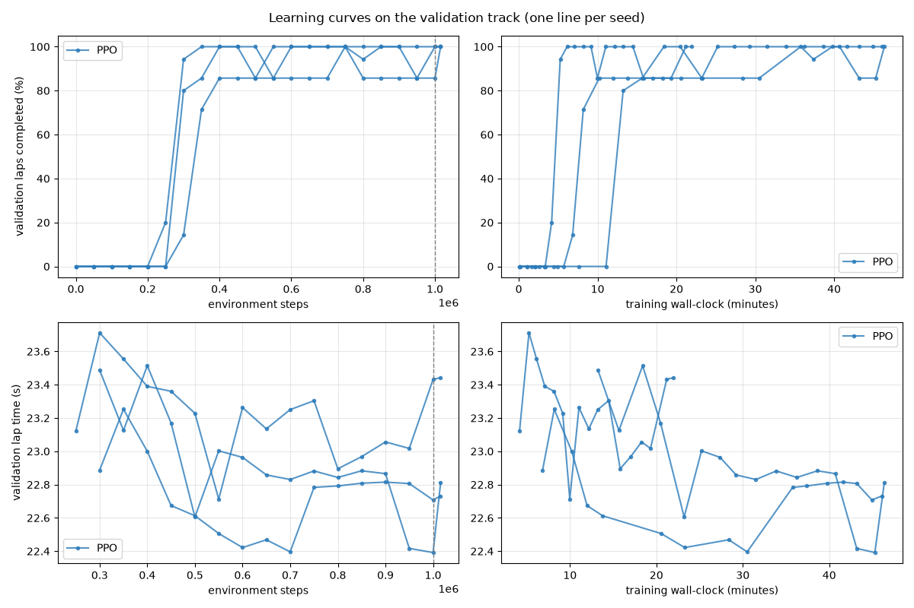
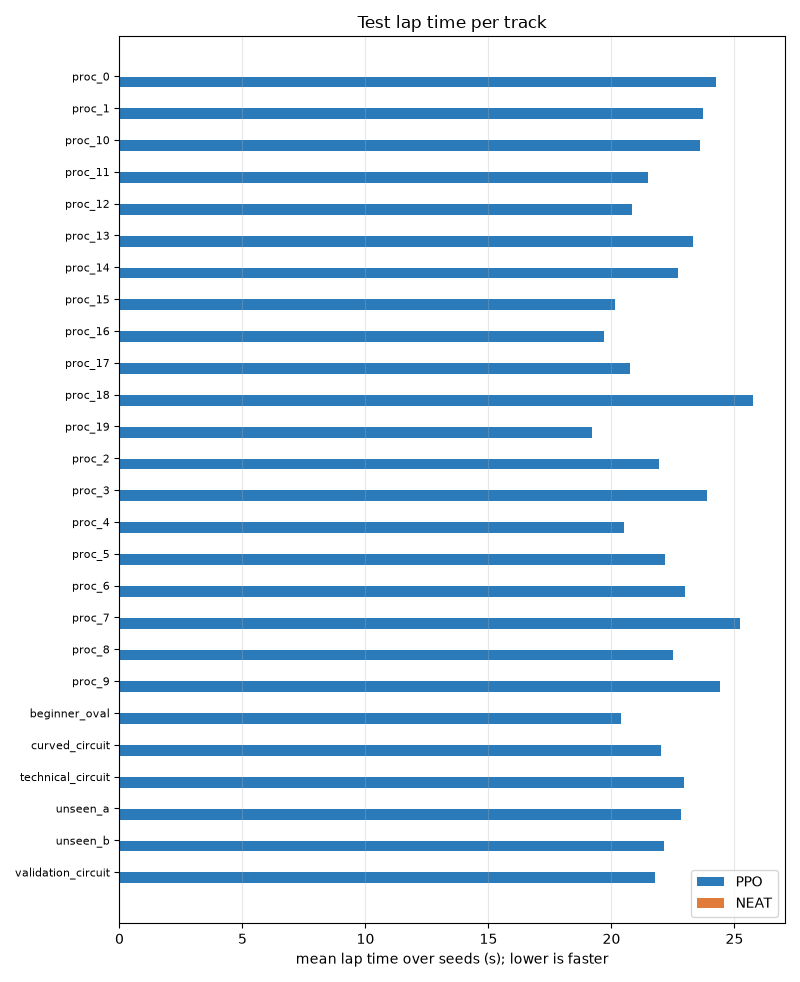

# Benchmark: ppo_default_s345

Generated by `neurodrive benchmark report`; do not edit by hand.

- Budget: **1,000,000 environment steps** per training run
- Seeds: 3, 4, 5 for each algorithm
- Training configs: `configs/ppo/multitrack.yaml`, `configs/neat/multitrack.yaml`
- Test: tracks `beginner_oval,curved_circuit,technical_circuit,validation_circuit,unseen_a,unseen_b,proc:20`, 20 test scenarios per track, random start True

## Per run

| Algorithm | Seed | Env steps used | Train time | First val. lap at | All val. laps at | Best model at | Test laps | Test lap time | Test collisions |
|---|---|---|---|---|---|---|---|---|---|
| PPO | 3 | 1,015,808 | 21.5 min | 250,000 | 350,000 | 650,000 | 515/520 | 22.59 s | 1.0% |
| PPO | 4 | 1,015,808 | 45.5 min | 300,000 | 750,000 | 1,000,000 | 486/520 | 22.15 s | 6.5% |
| PPO | 5 | 1,015,808 | 45.7 min | 300,000 | 400,000 | 1,015,808 | 470/520 | 22.10 s | 9.6% |

## Across seeds

| | PPO | NEAT |
|---|---|---|
| Test laps completed (%) | 94.3 ± 4.4 (range 90.4 to 99.0, n = 3) | — |
| Test lap time (s) | 22.28 ± 0.27 (range 22.10 to 22.59, n = 3) | — |
| Test collisions (%) | 5.7 ± 4.4 (range 1.0 to 9.6, n = 3) | — |
| Steps to first validation lap | 283,333 ± 28,868 (range 250,000 to 300,000, n = 3) | — |
| Steps to all validation laps | 500,000 ± 217,945 (range 350,000 to 750,000, n = 3) | — |
| Env steps used | 1,015,808 ± 0 (range 1,015,808 to 1,015,808, n = 3) | — |
| Training wall-clock (min) | 37.6 ± 13.9 (range 21.5 to 45.7, n = 3) | — |
| Pooled test laps, PPO | 1471/1560 (95% CI 93.0 to 95.3%) | |

Values are mean ± standard deviation across seeds, with the range. With this few seeds, treat differences smaller than the ranges as unresolved.

- Mean lap time per track (averaged over seeds): NEAT faster on 0 of 26 tracks.
- Seed pairings (each PPO seed vs each NEAT seed, overall test lap time): NEAT faster in 0 of 0.

## Baselines (same test scenarios)

| Driver | Test laps | Lap time | Collisions |
|---|---|---|---|

## Charts

