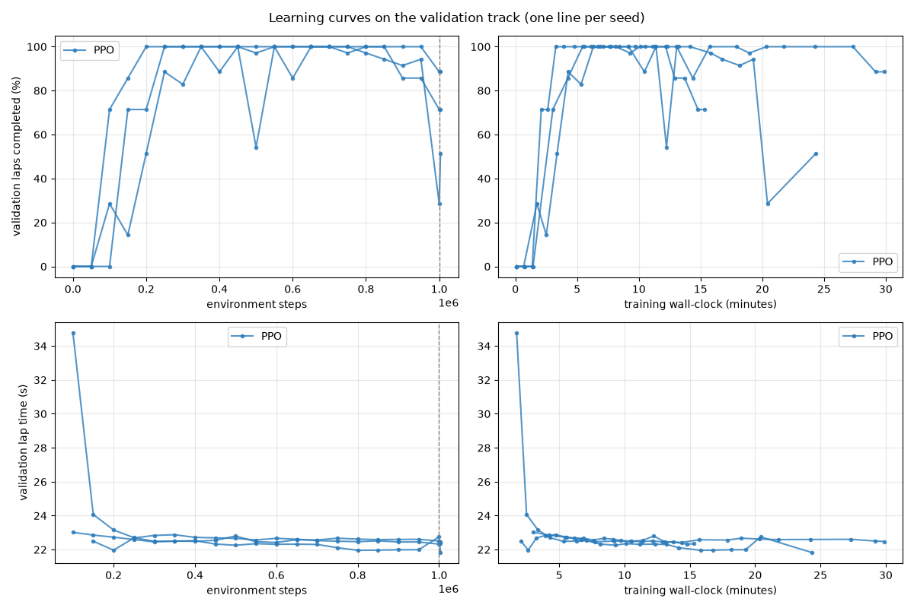
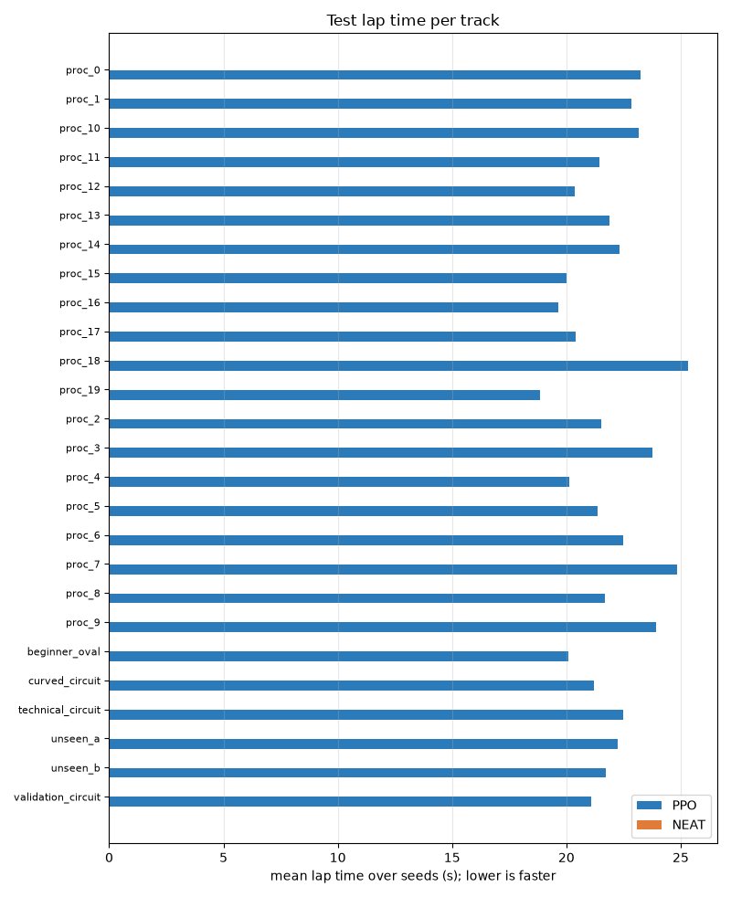

# Benchmark: ppo_tuned_s345

Generated by `neurodrive benchmark report`; do not edit by hand.

- Budget: **1,000,000 environment steps** per training run
- Seeds: 3, 4, 5 for each algorithm
- Training configs: `configs/ppo/tuned.yaml`, `configs/neat/multitrack.yaml`
- Test: tracks `beginner_oval,curved_circuit,technical_circuit,validation_circuit,unseen_a,unseen_b,proc:20`, 20 test scenarios per track, random start True

## Per run

| Algorithm | Seed | Env steps used | Train time | First val. lap at | All val. laps at | Best model at | Test laps | Test lap time | Test collisions |
|---|---|---|---|---|---|---|---|---|---|
| PPO | 3 | 1,003,520 | 14.9 min | 150,000 | 250,000 | 800,000 | 520/520 | 21.99 s | 0.0% |
| PPO | 4 | 1,003,520 | 20.5 min | 100,000 | 350,000 | 750,000 | 439/520 | 21.27 s | 15.6% |
| PPO | 5 | 1,003,520 | 29.2 min | 100,000 | 200,000 | 300,000 | 520/520 | 21.96 s | 0.0% |

## Across seeds

| | PPO | NEAT |
|---|---|---|
| Test laps completed (%) | 94.8 ± 9.0 (range 84.4 to 100.0, n = 3) | — |
| Test lap time (s) | 21.74 ± 0.41 (range 21.27 to 21.99, n = 3) | — |
| Test collisions (%) | 5.2 ± 9.0 (range 0.0 to 15.6, n = 3) | — |
| Steps to first validation lap | 116,667 ± 28,868 (range 100,000 to 150,000, n = 3) | — |
| Steps to all validation laps | 266,667 ± 76,376 (range 200,000 to 350,000, n = 3) | — |
| Env steps used | 1,003,520 ± 0 (range 1,003,520 to 1,003,520, n = 3) | — |
| Training wall-clock (min) | 21.5 ± 7.3 (range 14.9 to 29.2, n = 3) | — |
| Pooled test laps, PPO | 1479/1560 (95% CI 93.6 to 95.8%) | |

Values are mean ± standard deviation across seeds, with the range. With this few seeds, treat differences smaller than the ranges as unresolved.

- Mean lap time per track (averaged over seeds): NEAT faster on 0 of 26 tracks.
- Seed pairings (each PPO seed vs each NEAT seed, overall test lap time): NEAT faster in 0 of 0.

## Baselines (same test scenarios)

| Driver | Test laps | Lap time | Collisions |
|---|---|---|---|

## Charts

