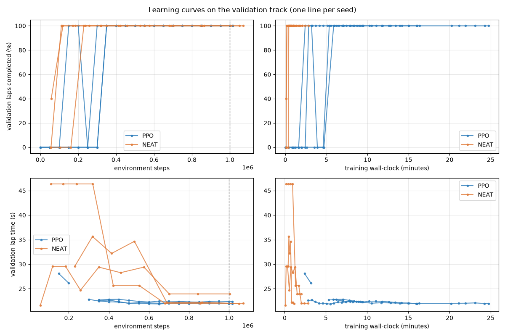
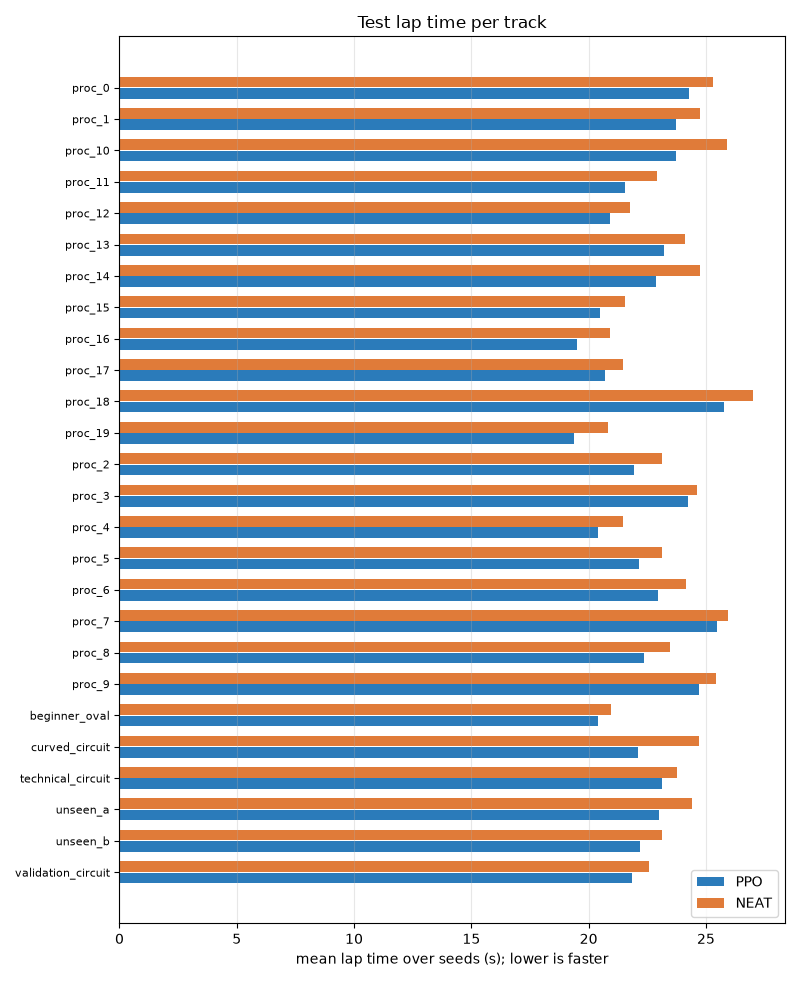

# Benchmark: ppo_vs_neat_1m

Generated by `neurodrive benchmark report`; do not edit by hand.

- Budget: **1,000,000 environment steps** per training run
- Seeds: 0, 1, 2 for each algorithm
- Training configs: `configs/ppo/multitrack.yaml`, `configs/neat/multitrack.yaml`
- Test: tracks `beginner_oval,curved_circuit,technical_circuit,validation_circuit,unseen_a,unseen_b,proc:20`, 20 test scenarios per track, random start True

## Per run

| Algorithm | Seed | Env steps used | Train time | First val. lap at | All val. laps at | Best model at | Test laps | Test lap time | Test collisions |
|---|---|---|---|---|---|---|---|---|---|
| NEAT | 0 | 1,050,842 | 1.1 min | 229,741 | 229,741 | 1,050,842 | 520/520 | 22.73 s | 0.0% |
| NEAT | 1 | 1,003,470 | 2.1 min | 57,760 | 119,290 | 701,528 | 502/520 | 24.39 s | 3.5% |
| NEAT | 2 | 1,071,614 | 2.9 min | 111,113 | 111,113 | 679,924 | 514/520 | 23.50 s | 1.2% |
| PPO | 0 | 1,015,808 | 9.1 min | 350,000 | 350,000 | 650,000 | 502/520 | 22.48 s | 3.5% |
| PPO | 1 | 1,015,808 | 16.2 min | 150,000 | 150,000 | 1,000,000 | 520/520 | 22.45 s | 0.0% |
| PPO | 2 | 1,015,808 | 24.6 min | 300,000 | 300,000 | 1,015,808 | 423/520 | 21.98 s | 18.7% |

## Across seeds

| | PPO | NEAT |
|---|---|---|
| Test laps completed (%) | 92.6 ± 9.9 (range 81.3 to 100.0, n = 3) | 98.5 ± 1.8 (range 96.5 to 100.0, n = 3) |
| Test lap time (s) | 22.30 ± 0.28 (range 21.98 to 22.48, n = 3) | 23.54 ± 0.83 (range 22.73 to 24.39, n = 3) |
| Test collisions (%) | 7.4 ± 9.9 (range 0.0 to 18.7, n = 3) | 1.5 ± 1.8 (range 0.0 to 3.5, n = 3) |
| Steps to first validation lap | 266,667 ± 104,083 (range 150,000 to 350,000, n = 3) | 132,871 ± 88,031 (range 57,760 to 229,741, n = 3) |
| Steps to all validation laps | 266,667 ± 104,083 (range 150,000 to 350,000, n = 3) | 153,381 ± 66,256 (range 111,113 to 229,741, n = 3) |
| Env steps used | 1,015,808 ± 0 (range 1,015,808 to 1,015,808, n = 3) | 1,041,975 ± 34,927 (range 1,003,470 to 1,071,614, n = 3) |
| Training wall-clock (min) | 16.6 ± 7.8 (range 9.1 to 24.6, n = 3) | 2.0 ± 0.9 (range 1.1 to 2.9, n = 3) |
| Pooled test laps, PPO | 1445/1560 (95% CI 91.2 to 93.8%) | |
| Pooled test laps, NEAT | 1536/1560 (95% CI 97.7 to 99.0%) | |

Values are mean ± standard deviation across seeds, with the range. With this few seeds, treat differences smaller than the ranges as unresolved.

- Mean lap time per track (averaged over seeds): NEAT faster on 0 of 26 tracks.
- Seed pairings (each PPO seed vs each NEAT seed, overall test lap time): NEAT faster in 0 of 9.

## Baselines (same test scenarios)

| Driver | Test laps | Lap time | Collisions |
|---|---|---|---|
| heuristic | 520/520 | 29.56 s | 0.0% |
| autopilot | 520/520 | 28.02 s | 0.0% |
| smoothed_random | 0/520 | — s | 57.9% |

## Charts

