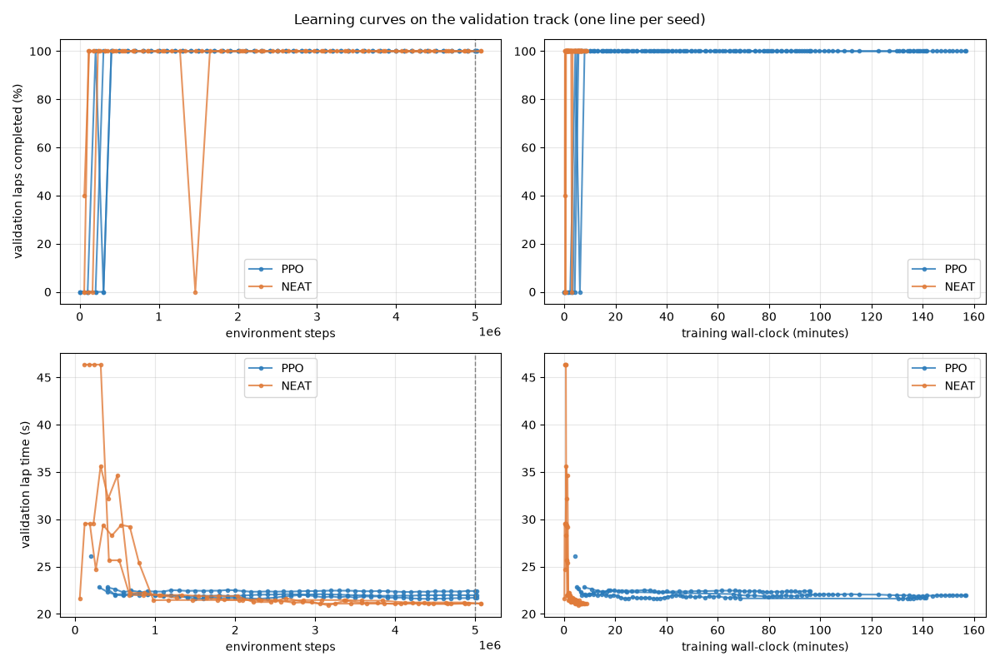
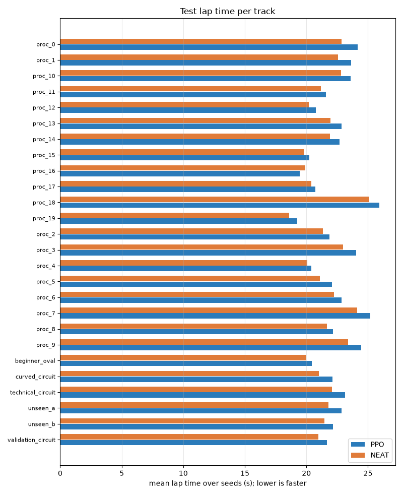

# Benchmark: ppo_vs_neat_5m

Generated by `neurodrive benchmark report`; do not edit by hand.

- Budget: **5,000,000 environment steps** per training run
- Seeds: 0, 1, 2 for each algorithm
- Training configs: `configs/ppo/multitrack.yaml`, `configs/neat/multitrack.yaml`
- Test: tracks `beginner_oval,curved_circuit,technical_circuit,validation_circuit,unseen_a,unseen_b,proc:20`, 20 test scenarios per track, random start True

## Per run

| Algorithm | Seed | Env steps used | Train time | First val. lap at | All val. laps at | Best model at | Test laps | Test lap time | Test collisions |
|---|---|---|---|---|---|---|---|---|---|
| NEAT | 0 | 5,073,937 | 8.7 min | 229,741 | 229,741 | 3,163,631 | 520/520 | 21.67 s | 0.0% |
| NEAT | 1 | 5,071,870 | 6.6 min | 57,760 | 119,290 | 5,071,870 | 520/520 | 21.66 s | 0.0% |
| NEAT | 2 | 4,912,516 | 6.9 min | 111,113 | 111,113 | 3,060,415 | 520/520 | 21.44 s | 0.0% |
| PPO | 0 | 5,013,504 | 95.8 min | 400,000 | 400,000 | 600,000 | 520/520 | 22.50 s | 0.0% |
| PPO | 1 | 5,013,504 | 156.8 min | 200,000 | 200,000 | 1,400,000 | 391/520 | 22.40 s | 24.8% |
| PPO | 2 | 5,013,504 | 141.0 min | 300,000 | 300,000 | 4,400,000 | 459/520 | 22.17 s | 11.7% |

## Across seeds

| | PPO | NEAT |
|---|---|---|
| Test laps completed (%) | 87.8 ± 12.4 (range 75.2 to 100.0, n = 3) | 100.0 ± 0.0 (range 100.0 to 100.0, n = 3) |
| Test lap time (s) | 22.36 ± 0.17 (range 22.17 to 22.50, n = 3) | 21.59 ± 0.13 (range 21.44 to 21.67, n = 3) |
| Test collisions (%) | 12.2 ± 12.4 (range 0.0 to 24.8, n = 3) | 0.0 ± 0.0 (range 0.0 to 0.0, n = 3) |
| Steps to first validation lap | 300,000 ± 100,000 (range 200,000 to 400,000, n = 3) | 132,871 ± 88,031 (range 57,760 to 229,741, n = 3) |
| Steps to all validation laps | 300,000 ± 100,000 (range 200,000 to 400,000, n = 3) | 153,381 ± 66,256 (range 111,113 to 229,741, n = 3) |
| Env steps used | 5,013,504 ± 0 (range 5,013,504 to 5,013,504, n = 3) | 5,019,441 ± 92,606 (range 4,912,516 to 5,073,937, n = 3) |
| Training wall-clock (min) | 131.2 ± 31.6 (range 95.8 to 156.8, n = 3) | 7.4 ± 1.2 (range 6.6 to 8.7, n = 3) |
| Pooled test laps, PPO | 1370/1560 (95% CI 86.1 to 89.4%) | |
| Pooled test laps, NEAT | 1560/1560 (95% CI 99.8 to 100.0%) | |

Values are mean ± standard deviation across seeds, with the range. With this few seeds, treat differences smaller than the ranges as unresolved.

- Mean lap time per track (averaged over seeds): NEAT faster on 25 of 26 tracks.
- Seed pairings (each PPO seed vs each NEAT seed, overall test lap time): NEAT faster in 9 of 9.

## Baselines (same test scenarios)

| Driver | Test laps | Lap time | Collisions |
|---|---|---|---|
| heuristic | 520/520 | 29.56 s | 0.0% |
| autopilot | 520/520 | 28.02 s | 0.0% |
| smoothed_random | 0/520 | — s | 57.9% |

## Charts

