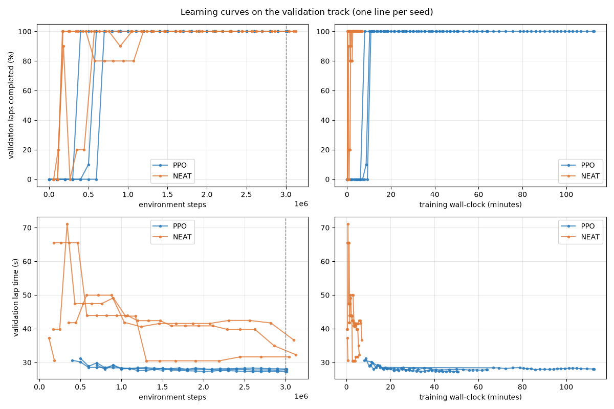
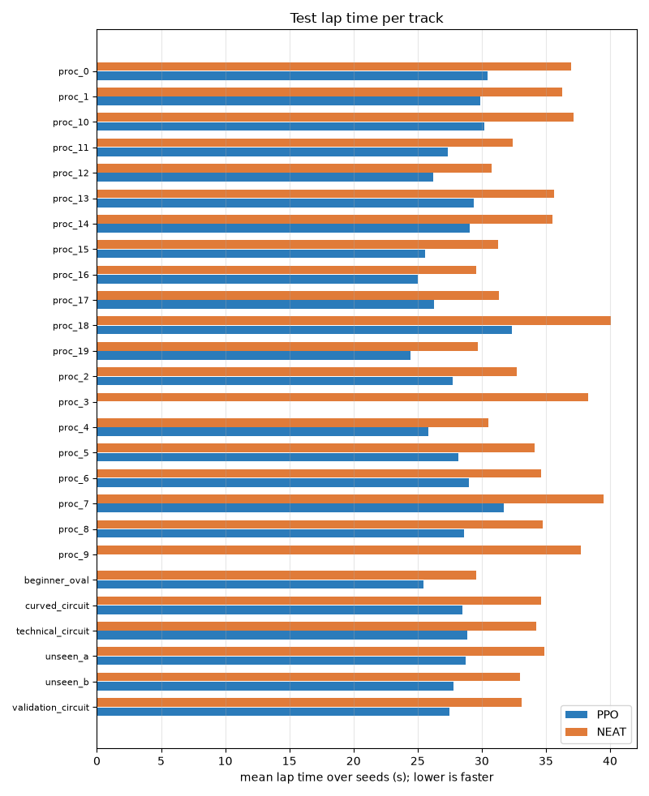

# Benchmark: ppo_vs_neat_dynamic_3m

Generated by `neurodrive benchmark report`; do not edit by hand.

- Budget: **3,000,000 environment steps** per training run
- Seeds: 0, 1, 2 for each algorithm
- Training configs: `configs/ppo/dynamic.yaml`, `configs/neat/dynamic.yaml`
- Test: tracks `beginner_oval,curved_circuit,technical_circuit,validation_circuit,unseen_a,unseen_b,proc:20`, 20 test scenarios per track, random start True

## Per run

| Algorithm | Seed | Env steps used | Train time | First val. lap at | All val. laps at | Best model at | Test laps | Test lap time | Test collisions |
|---|---|---|---|---|---|---|---|---|---|
| NEAT | 0 | 3,126,784 | 5.9 min | 177,062 | 177,062 | 3,126,784 | 511/520 | 33.16 s | 1.7% |
| NEAT | 1 | 3,098,672 | 7.1 min | 116,640 | 574,025 | 3,098,672 | 381/520 | 35.62 s | 0.2% |
| NEAT | 2 | 3,043,148 | 5.0 min | 170,070 | 170,070 | 1,304,134 | 482/520 | 33.08 s | 3.7% |
| PPO | 0 | 3,014,656 | 63.9 min | 700,000 | 700,000 | 1,200,000 | 415/520 | 27.87 s | 20.2% |
| PPO | 1 | 3,014,656 | 112.4 min | 400,000 | 400,000 | 1,700,000 | 418/520 | 27.70 s | 19.6% |
| PPO | 2 | 3,014,656 | 50.5 min | 500,000 | 600,000 | 2,600,000 | 372/520 | 27.70 s | 28.5% |

## Across seeds

| | PPO | NEAT |
|---|---|---|
| Test laps completed (%) | 77.2 ± 4.9 (range 71.5 to 80.4, n = 3) | 88.1 ± 13.1 (range 73.3 to 98.3, n = 3) |
| Test lap time (s) | 27.75 ± 0.10 (range 27.70 to 27.87, n = 3) | 33.95 ± 1.44 (range 33.08 to 35.62, n = 3) |
| Test collisions (%) | 22.8 ± 4.9 (range 19.6 to 28.5, n = 3) | 1.9 ± 1.7 (range 0.2 to 3.7, n = 3) |
| Steps to first validation lap | 533,333 ± 152,753 (range 400,000 to 700,000, n = 3) | 154,591 ± 33,052 (range 116,640 to 177,062, n = 3) |
| Steps to all validation laps | 566,667 ± 152,753 (range 400,000 to 700,000, n = 3) | 307,052 ± 231,232 (range 170,070 to 574,025, n = 3) |
| Env steps used | 3,014,656 ± 0 (range 3,014,656 to 3,014,656, n = 3) | 3,089,535 ± 42,560 (range 3,043,148 to 3,126,784, n = 3) |
| Training wall-clock (min) | 75.6 ± 32.6 (range 50.5 to 112.4, n = 3) | 6.0 ± 1.0 (range 5.0 to 7.1, n = 3) |
| Pooled test laps, PPO | 1205/1560 (95% CI 75.1 to 79.3%) | |
| Pooled test laps, NEAT | 1374/1560 (95% CI 86.4 to 89.6%) | |

Values are mean ± standard deviation across seeds, with the range. With this few seeds, treat differences smaller than the ranges as unresolved.

- Mean lap time per track (averaged over seeds): NEAT faster on 0 of 26 tracks.
- Seed pairings (each PPO seed vs each NEAT seed, overall test lap time): NEAT faster in 0 of 9.

## Baselines (same test scenarios)

| Driver | Test laps | Lap time | Collisions |
|---|---|---|---|
| heuristic | 156/520 | 32.04 s | 70.0% |
| autopilot | 520/520 | 38.03 s | 0.0% |
| smoothed_random | 0/520 | — s | 51.7% |

## Charts

