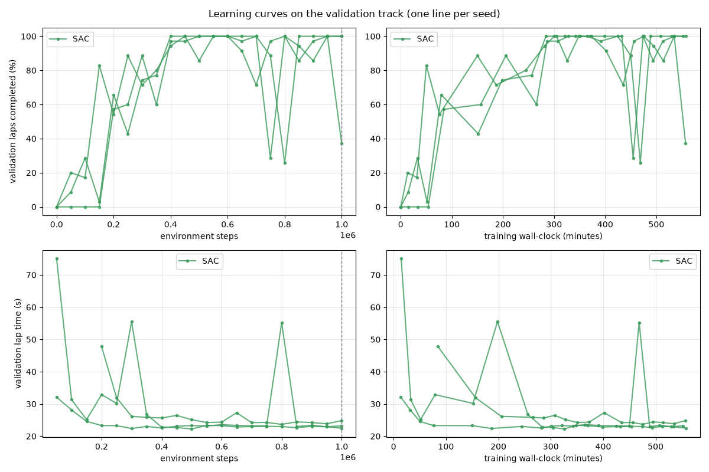
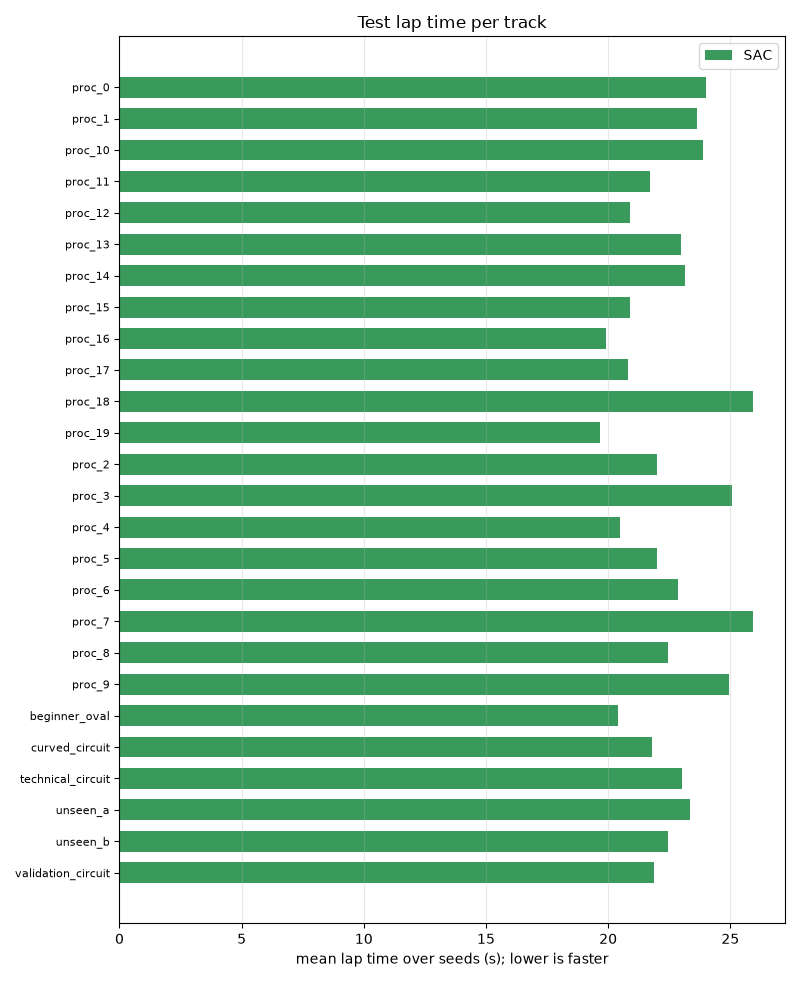

# Benchmark: sac_1m

Generated by `neurodrive benchmark report`; do not edit by hand.

- Budget: **1,000,000 environment steps** per training run
- Seeds: 0, 1, 2 for each algorithm
- Training configs: `configs/sac/multitrack.yaml`
- Test: tracks `beginner_oval,curved_circuit,technical_circuit,validation_circuit,unseen_a,unseen_b,proc:20`, 20 test scenarios per track, random start True

## Per run

| Algorithm | Seed | Env steps used | Train time | First val. lap at | All val. laps at | Best model at | Test laps | Test lap time | Test collisions |
|---|---|---|---|---|---|---|---|---|---|
| SAC | 0 | 1,000,000 | 557.2 min | 200,000 | 500,000 | 800,000 | 516/520 | 23.15 s | 0.0% |
| SAC | 1 | 1,000,000 | 557.8 min | 50,000 | 400,000 | 1,000,000 | 502/520 | 21.89 s | 3.5% |
| SAC | 2 | 1,000,000 | 552.3 min | 50,000 | 450,000 | 950,000 | 508/520 | 22.46 s | 1.2% |

## Across seeds

| | SAC |
|---|---|
| Test laps completed (%) | 97.8 ± 1.4 (range 96.5 to 99.2, n = 3) |
| Test lap time (s) | 22.50 ± 0.63 (range 21.89 to 23.15, n = 3) |
| Test collisions (%) | 1.5 ± 1.8 (range 0.0 to 3.5, n = 3) |
| Steps to first validation lap | 100,000 ± 86,603 (range 50,000 to 200,000, n = 3) |
| Steps to all validation laps | 450,000 ± 50,000 (range 400,000 to 500,000, n = 3) |
| Env steps used | 1,000,000 ± 0 (range 1,000,000 to 1,000,000, n = 3) |
| Training wall-clock (min) | 555.8 ± 3.0 (range 552.3 to 557.8, n = 3) |
| Pooled test laps, SAC | 1526/1560 (95% CI 97.0 to 98.4%) |

Values are mean ± standard deviation across seeds, with the range. With this few seeds, treat differences smaller than the ranges as unresolved.

## Baselines (same test scenarios)

| Driver | Test laps | Lap time | Collisions |
|---|---|---|---|

## Charts

